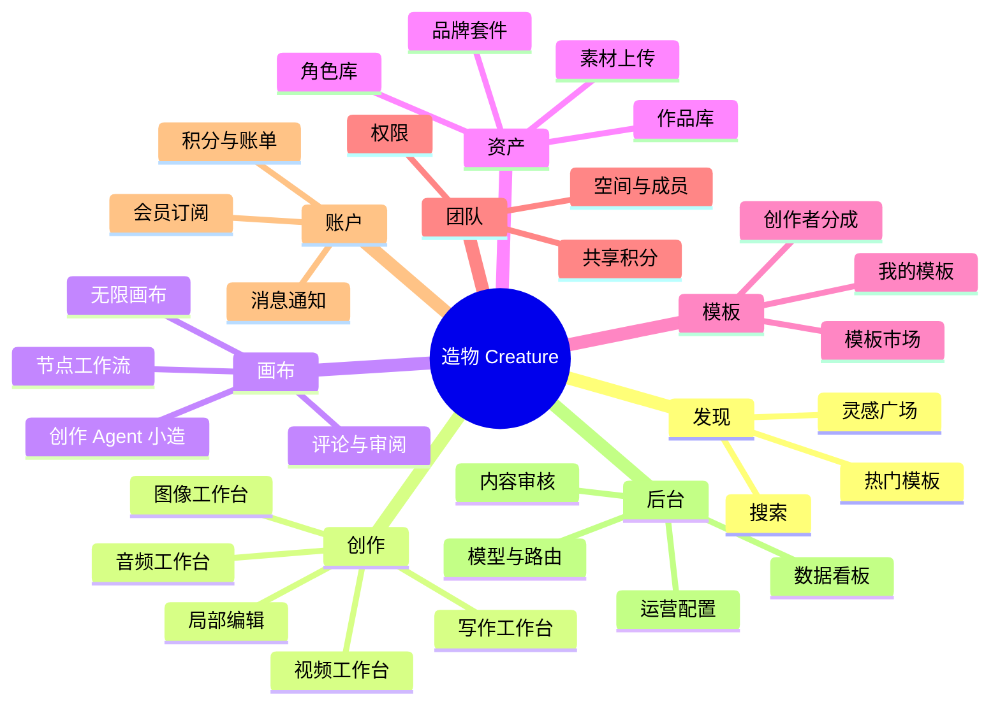
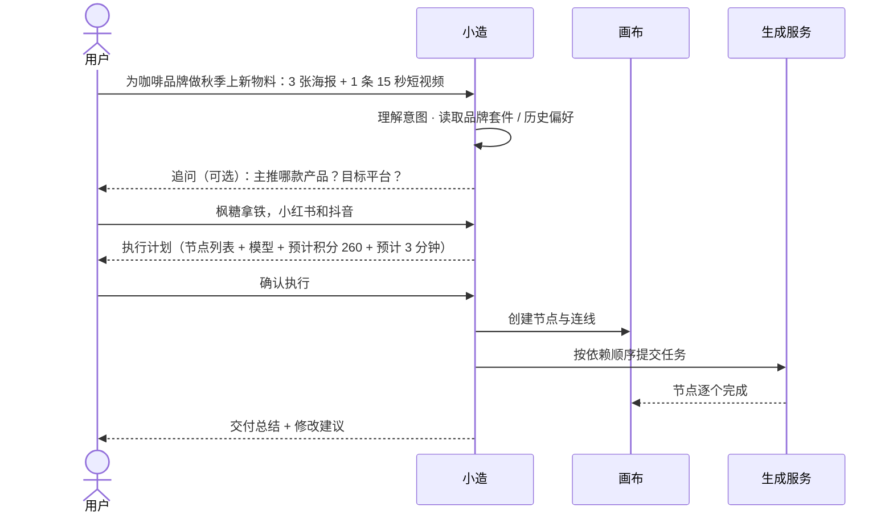

# 02 · 产品需求文档（PRD）

> 产品：造物 Creature
> 版本：v1.0（MVP + Beta 规划）
> 关联文档：[01 竞品调研](./01-competitive-analysis.md) · [03 技术架构](./03-architecture.md) · [06 UI 交互规范](./06-ui-design.md)

## 1. 产品概述

### 1.1 一句话定位

造物是面向中文创作者与中小品牌团队的 **Agent 驱动全模态创作平台**：在一张无限画布上，用一句话完成从文案、图像、视频到配音、音乐的整套内容生产。

### 1.2 产品目标（上线后 12 个月）

| 目标 | 指标 | 目标值 |
|---|---|---|
| 规模 | 注册用户 | 100 万 |
| 活跃 | 周活跃创作者（WAC，周内至少 1 次成功生成） | 15 万 |
| 付费 | 付费转化率（付费用户 / 月活） | ≥ 6% |
| 收入 | 月经常性收入（MRR） | 500 万元 |
| 效率 | 单件成品平均生成次数（越低越好，衡量"抽卡"成本） | ≤ 4 次 |
| 质量 | 生成成功率（非用户取消） | ≥ 97% |

**北极星指标**：每周被下载 / 导出 / 发布的成品数（衡量真正"被用起来"的内容，而非单纯生成量）。

### 1.3 目标用户

| 画像 | 描述 | 核心需求 | 付费意愿 |
|---|---|---|---|
| **A. 自媒体创作者**（主力） | 小红书 / 抖音 / B 站博主，日更压力大 | 快速出封面、配图、短视频；风格稳定 | 中，39–99 元/月 |
| **B. 中小品牌营销** | 电商、餐饮、新消费品牌的 1–5 人市场团队 | 海报、商品图、广告短片；品牌一致；可商用 | 高，按团队付费 |
| **C. AI 短剧 / 漫剧团队** | 3–20 人的内容工作室 | 剧本拆分镜、角色一致、批量出镜头、配音 | 高，量大 |
| **D. 设计师 / 插画师** | 专业用户，把 AI 当生产力工具 | 精细控制、局部编辑、工作流复用 | 中高 |
| E. 学生与爱好者 | 兴趣驱动 | 免费额度、社区灵感 | 低，拉新与社区内容来源 |

### 1.4 核心用户场景

1. **小红书博主林夏**：输入"秋季咖啡探店，3 张封面 + 1 段 10 秒视频"，Agent 生成计划 → 确认 → 2 分钟后画布上出现全部素材 → 圈选修改杯子上的文字 → 导出。
2. **茶饮品牌市场经理老周**：在品牌套件中上传 Logo、标准色、字体；团队成员用"新品海报"模板生成的物料自动套用品牌规范；经理在画布上评论审批。
3. **漫剧工作室导演阿杰**：上传 2 万字剧本 → 自动拆出角色表、场景表、分镜表 → 为 4 个主角建立角色卡 → 批量生成 60 个镜头 → 配音 → 导出剪辑工程。

## 2. 功能架构

## 3. 功能清单与优先级

优先级：**P0** = MVP 必须；**P1** = Beta 版本；**P2** = 后续迭代。

| 模块 | 功能 | 优先级 | 版本 |
|---|---|---|---|
| 账号 | 手机号验证码登录、微信扫码登录 | P0 | MVP |
| 账号 | 实名信息（手机号即满足基础实名）、未成年人模式 | P0 | MVP |
| 账号 | 邮箱 / Apple 登录（海外版） | P2 | — |
| 发现 | 首页提示词入口 + 模式切换 | P0 | MVP |
| 发现 | 灵感广场（瀑布流、筛选、一键同款） | P0 | MVP |
| 发现 | 个性化推荐、关注流 | P1 | Beta |
| 创作 | 文生图 / 图生图 / 参考图 | P0 | MVP |
| 创作 | 局部重绘、扩图、消除、抠图、超分 | P0 | MVP |
| 创作 | 文生视频 / 图生视频 / 首尾帧 | P0 | MVP |
| 创作 | 视频延长、对口型、多镜头 | P1 | Beta |
| 创作 | AI 写作（文案、脚本、剧本、分镜表） | P0 | MVP |
| 创作 | 配音（TTS 多音色）、背景音乐生成 | P1 | Beta |
| 创作 | 声音克隆（需授权核验） | P2 | — |
| 创作 | 智能模型路由（自动 / 手动） | P0 | MVP |
| 画布 | 无限画布、节点增删连线、自动执行 | P1 | Beta |
| 画布 | 创作 Agent 小造（规划 → 预估 → 执行） | P1 | Beta |
| 画布 | 多人实时协作、评论 | P2 | — |
| 资产 | 作品库（文件夹、标签、搜索） | P0 | MVP |
| 资产 | 角色库（参考图组 + 一致性生成） | P1 | Beta |
| 资产 | 品牌套件 | P1 | Beta |
| 模板 | 官方模板（单步 + 多步） | P0 | MVP |
| 模板 | 用户发布模板、积分分成 | P2 | — |
| 团队 | 团队空间、成员邀请、角色权限、共享积分池 | P1 | Beta |
| 计费 | 订阅（微信 / 支付宝）、积分包、积分流水、发票 | P0 | MVP |
| 计费 | 企业对公转账、合同 | P2 | — |
| 合规 | 显式 / 隐式标识、输入输出审核、备案公示、举报 | P0 | MVP |
| 开放 | 开放 API、Agent Skill 接口 | P2 | — |
| 后台 | 数据看板、用户管理、模型管理、审核台、运营配置 | P0 | MVP |

## 4. 详细功能说明

### 4.1 账号体系

**登录方式**：手机号 + 短信验证码（默认）、微信扫码。首次登录自动注册并赠送新手积分（100 积分，7 天有效）。

**业务规则**：
- 同一手机号只能绑定一个账号；微信账号可后绑手机号，未绑定手机号的账号不可使用生成功能（满足实名要求）。
- 连续登录送积分：每日首次登录送 20 积分（当日有效），对标可灵每日赠送机制。
- 登录态：Access Token 2 小时，Refresh Token 30 天，多端最多同时 5 个会话。

**验收标准**：
- 验证码 60 秒内送达率 ≥ 99%；同一手机号 1 分钟内最多发送 1 次，1 天内最多 10 次。
- 微信扫码到登录成功 ≤ 3 秒（P95）。

### 4.2 首页与灵感广场

**首页结构**：顶部大输入框（"描述你想创作的内容"）+ 模式标签（Agent / 图像 / 视频 / 写作 / 音频）+ 快捷参数（比例、模型）→ 热门模板横滑 → 灵感广场瀑布流。

**交互要点**：
- 在首页直接输入并回车：Agent 模式进入新画布；其他模式进入对应工作台并自动开始生成。
- 作品卡片悬停显示：提示词摘要、模型、作者；点击打开详情（大图 / 视频播放、完整参数、"做同款"按钮）。
- "做同款"：把提示词、参数、参考图带入工作台，用户可修改后生成。作者可设置"隐藏提示词"。

**筛选**：类型（图像 / 视频 / 音频 / 模板）、风格标签、排序（推荐 / 最新 / 最热）。

### 4.3 创作工作台

四个工作台共用同一布局：**左侧参数面板 · 中间结果区 · 右侧历史记录**。

#### 4.3.1 图像工作台

| 参数 | 说明 | 默认 |
|---|---|---|
| 提示词 | 最多 2000 字；支持"AI 润色"一键扩写 | — |
| 模型 | 自动（推荐）/ 手动选择；每个模型显示速度、质量星级、单张积分 | 自动 |
| 参考图 | 最多 4 张，可设置参考类型：风格 / 构图 / 主体 / 角色 | 无 |
| 比例 | 1:1、3:4、4:3、9:16、16:9、21:9、自定义 | 3:4 |
| 分辨率 | 标准（1K）/ 高清（2K）/ 超清（4K） | 标准 |
| 数量 | 1–4 张 | 4 |
| 负向提示词 | 高级选项，折叠 | 空 |
| 种子 | 高级选项，可锁定 | 随机 |

**结果区**：任务卡片显示排队位置 → 进度 → 结果网格。单张结果可执行：放大查看、下载、收藏到资产库、再次生成、变体、局部重绘、扩图、超分、生成视频、发布到广场、加入画布。

**局部编辑**：
- 局部重绘：画笔 / 套索圈选区域 + 描述修改内容。
- 文字直改：识别图中文字（OCR）后直接改文字，保持字体风格。
- 扩图：拖拽画框到目标比例。
- 消除 / 抠图：点选主体。
- 图层拆分（P1）：将图像拆成主体、背景、文字等图层，单独编辑后合成。

#### 4.3.2 视频工作台

| 参数 | 说明 |
|---|---|
| 生成方式 | 文生视频、图生视频（首帧）、首尾帧、参考视频（动作参考，P1） |
| 模型 | 自动 / 手动；显示每秒积分、最长时长、是否支持原生音频 |
| 时长 | 5 / 10 / 15 秒（受模型限制） |
| 分辨率 | 720p / 1080p / 4K（受模型限制） |
| 运镜 | 推、拉、摇、移、跟、环绕、固定；强度滑杆 |
| 原生音频 | 开 / 关（开启后积分 ×1.5） |
| 角色 | 从角色库选择（P1） |

**业务规则**：视频任务通常耗时 1–5 分钟，提交后用户可离开页面；完成后站内消息 + 浏览器通知（需授权）提醒。

#### 4.3.3 写作工作台

- 左侧选择文体模板：小红书笔记、短视频脚本、广告文案、产品详情、公众号文章、剧本、分镜表。
- 中间为富文本编辑器，AI 输出流式显示；支持选中文字后"改写 / 扩写 / 缩写 / 换语气 / 翻译"。
- **分镜表**输出为结构化表格（镜号、景别、画面描述、台词、时长），可一键"发送到画布"，每行自动生成一个图像节点。

#### 4.3.4 音频工作台（P1）

- 配音：选择音色（按性别、年龄、风格筛选，可试听），输入文本，调节语速、情绪；支持多角色对话脚本。
- 音乐：描述风格 / 情绪 / 时长，生成背景音乐；可选是否带人声。
- 声音克隆（P2）：必须上传本人朗读的授权声明音频，并经人工审核。

### 4.4 智能模型路由

**目标**：让不懂模型的用户也能获得合适的结果，同时控制平台成本。

**用户可见的三种策略**：

| 策略 | 说明 |
|---|---|
| 自动（默认） | 根据任务类型、提示词特征（如含中文文字、人像、动漫风格）、用户历史偏好推荐模型 |
| 省积分 | 在满足最低质量分的模型中选积分最低的 |
| 最佳质量 | 选质量评分最高的模型 |

**规则**：
- 自动模式最终选中的模型和积分消耗**在提交前展示**，用户可改。
- 主模型故障或超时时自动切换到同级备选模型；若备选模型更贵，差额由平台承担。
- 路由策略和模型评分在后台可配置（见 4.10）。

### 4.5 无限画布与节点工作流（P1）

**画布元素**：

| 节点类型 | 输入 | 输出 | 说明 |
|---|---|---|---|
| 文本节点 | — | 文本 | 用户输入或 AI 写作结果 |
| 图像生成节点 | 文本、图像（参考） | 图像 × N | 参数同图像工作台 |
| 图像编辑节点 | 图像、文本 | 图像 | 重绘 / 扩图 / 抠图 / 超分 |
| 视频生成节点 | 文本、图像（首帧 / 尾帧） | 视频 | 参数同视频工作台 |
| 配音节点 | 文本 | 音频 | — |
| 音乐节点 | 文本 | 音频 | — |
| 角色节点 | — | 角色引用 | 从角色库拖入 |
| 品牌节点 | — | 品牌规范 | 从品牌套件拖入 |
| 合成节点（P2） | 视频、音频 | 视频 | 简单剪辑拼接 |
| 便签 / 分组 | — | — | 说明与整理 |

**交互**：
- 拖拽画布、滚轮缩放（10%–400%）、框选、对齐吸附、小地图。
- 从节点右侧"输出口"拖线到另一个节点的"输入口"建立连接；类型不匹配时连线变红并提示。
- 节点状态：草稿 → 排队 → 生成中（进度）→ 完成 / 失败。
- 点击"运行"：执行选中节点；"运行全部"：按依赖拓扑顺序执行，执行前弹出积分预估。
- 上游节点结果变更后，下游节点显示"已过期"标记，用户决定是否重新运行。

**验收标准**：
- 500 个节点的画布，拖拽帧率 ≥ 50 FPS。
- 画布自动保存，间隔 ≤ 3 秒；离线编辑后恢复网络能自动同步。

### 4.6 创作 Agent「小造」（P1）

**定位**：画布右侧的对话面板，负责理解目标、拆解任务、调度模型、汇总结果。用户始终保有最终决定权。

**标准流程**：

**Agent 能力（工具）**：写作、生成图像、编辑图像、生成视频、配音、音乐、检索资产库、读取品牌套件 / 角色、创建 / 修改画布节点、估算积分。

**规则**：
- **先计划后执行**：涉及积分消耗的操作必须先展示计划和预估积分，用户确认后执行；单次计划预估超过 300 积分时二次确认。
- 用户可在计划中删除、修改任一步骤后再执行。
- Agent 记忆：记住用户常用风格、比例、平台偏好（可在设置中查看与清除）。
- Agent 规划和对话本身不消耗积分（成本计入平台运营），执行生成按实际任务计费。

### 4.7 资产中心

#### 作品库
- 自动收录所有生成结果（保留 180 天；收藏的作品永久保留，付费用户总空间 50 GB 起）。
- 文件夹、标签、按类型 / 模型 / 时间筛选、语义搜索（"红色背景的猫"）。
- 支持上传本地素材（图片 ≤ 20 MB、视频 ≤ 500 MB、音频 ≤ 50 MB），上传内容同样过审。

#### 角色库（P1）
- 创建角色：名称、描述、3–8 张参考图（正面 / 侧面 / 全身），可选标准装扮和声音。
- 生成时引用角色，平台根据所选模型能力选择实现方式：主体参考接口（优先）或角色 LoRA（专业版可训练，消耗训练积分）。
- 涉及真人肖像时需上传肖像授权声明，未授权仅限本人使用。

#### 品牌套件（P1）
- 内容：Logo（多版本）、标准色（最多 8 个）、字体、品牌调性描述、禁用元素。
- 生成时勾选"应用品牌套件"，系统将品牌约束注入提示词并在海报类模板中自动放置 Logo。

### 4.8 模板市场

- **单步模板**：预设提示词 + 参数 + 示例图，用户只需替换关键词或上传图片（如"产品白底图换场景"）。
- **多步模板**：一组画布节点与连线（如"小红书封面 3 连图"、"商品 15 秒广告片"、"漫剧 1 集分镜"）。
- 模板详情页：示例效果、步骤说明、预计积分、使用次数、评分。
- **创作者分成（P2）**：用户发布的模板通过审核后上架；他人每次使用，作者获得该次消耗积分的 10%（以平台赠送积分形式发放）。

### 4.9 团队空间（P1）

| 角色 | 权限 |
|---|---|
| 所有者 | 全部权限，含账单与解散团队 |
| 管理员 | 成员管理、品牌套件管理、积分分配 |
| 成员 | 创作、使用团队资产与积分 |
| 访客 | 只能查看与评论被分享的画布 |

- 团队积分池：所有者可为成员设置每月积分上限。
- 资产归属：在团队空间内创作的作品归团队所有，成员离开后保留。

### 4.10 会员与积分

#### 套餐（建议价，上线前按成本测算调整）

| 套餐 | 价格 | 每月积分 | 主要权益 |
|---|---|---|---|
| 免费版 | 0 | 每日登录 20 积分 + 新手 100 积分 | 标准模型、标准队列、个人非商用 |
| 基础版 | 39 元/月（年付 29 元/月） | 600 | 全部图像模型、标准视频模型、商用授权、去平台水印 |
| 专业版 | 99 元/月（年付 79 元/月） | 1800 | 全部模型、优先队列、4K、角色库、品牌套件、Agent 无限会话 |
| 团队版 | 299 元/月起（含 3 席位，+79 元/席位） | 6000 共享 | 团队空间、共享资产、权限管理、评论审阅 |
| 企业版 | 定制 | 定制 | 开放 API、私有化模型接入、SSO、专属客服、对公结算 |

> "去平台水印"指去掉造物品牌 Logo；法规要求的"AI 生成"显式标识与隐式标识**任何套餐都不可去除**。

**积分包**：100 积分 10 元、500 积分 45 元、2000 积分 160 元（有效期 1 年）。

#### 积分消耗价目（v1）

| 能力 | 规格 | 积分 |
|---|---|---|
| 图像生成 | 标准模型 · 1K / 张 | 2 |
| 图像生成 | 高级模型 · 2K / 张 | 6 |
| 图像生成 | 旗舰模型 · 4K / 张 | 12 |
| 图像编辑 | 重绘 / 扩图 / 消除 / 抠图 | 2 |
| 超分 | 2× / 4× | 2 / 4 |
| 视频生成 | 标准 · 720p | 8 / 秒 |
| 视频生成 | 高清 · 1080p | 16 / 秒 |
| 视频生成 | 旗舰 · 1080p+，含运镜与多镜头 | 30 / 秒 |
| 视频原生音频 | 叠加 | 视频积分 × 1.5 |
| 写作 | 每 2000 字输出 | 1 |
| 配音 | 每 300 字 | 1 |
| 音乐 | 每首（≤ 2 分钟） | 15 |
| 角色训练 | 每个角色 | 60 |

#### 计费规则
1. **预扣 → 结算**：提交时冻结预估积分；成功后按实际扣除；失败、超时、审核拦截**全额返还**。
2. **消耗顺序**：先扣即将过期的积分（每日赠送 → 新手 → 订阅 → 积分包）。
3. **结转**：订阅积分可结转一个周期（如 10 月未用完的积分在 11 月底前有效）。
4. **余额不足**：提交按钮变为"积分不足，去充值"，展示差额与推荐套餐。
5. 所有积分变动在"积分明细"中可查（时间、类型、关联任务、变动值、余额）。

### 4.11 消息通知

- 站内信：任务完成 / 失败、积分到账、积分即将过期（提前 3 天）、模板审核结果、评论与 @、系统公告。
- 浏览器通知：长任务完成（用户授权后）。
- 短信：仅用于登录验证码和支付相关。

### 4.12 管理后台

| 模块 | 功能 |
|---|---|
| 数据看板 | 注册、活跃、生成量、成功率、付费、收入、模型成本、毛利 |
| 用户管理 | 查询、封禁、积分调整（需二人复核）、登录日志 |
| 模型管理 | 供应商与模型上下线、价格配置、路由权重、健康状态、熔断阈值 |
| 内容审核 | 机审结果复核队列、举报处理、违规样本库、关键词库 |
| 运营配置 | 首页 Banner、推荐位、模板上下架、活动与优惠券 |
| 财务 | 订单、退款、对账（供应商成本 vs 用户消耗） |
| 审计 | 后台操作日志，不可删除 |

### 4.13 合规功能（P0）

详见 [08-合规与内容安全](./08-compliance.md)，PRD 层面的要求：
- 所有生成内容自动添加显式标识（图像角标"AI 生成"、视频片头 / 角标、音频提示音或语音提示、文本末尾提示）与隐式标识（文件元数据）。
- 下载、复制、分享时保留标识。
- 提示词、上传素材、生成结果三道审核。
- 页脚与"关于"页公示所使用模型的名称与备案号 / 登记编号。
- 举报入口：每个作品详情页和画布分享页。

## 5. 非功能需求

| 类别 | 要求 |
|---|---|
| 性能 | 首页首屏 LCP ≤ 2.0 s（4G）；任务提交接口 P95 ≤ 300 ms；任务状态推送延迟 ≤ 1 s |
| 生成耗时 | 标准图像 P50 ≤ 15 s；5 秒标准视频 P50 ≤ 120 s（受供应商影响，需监控） |
| 可用性 | 核心链路（登录、提交、查询、支付）月可用性 ≥ 99.9% |
| 容量 | MVP 支撑日生成 50 万张图、2 万条视频；峰值任务提交 500 QPS |
| 安全 | 全站 HTTPS；敏感数据加密存储；接口鉴权与限流；OWASP Top 10 防护 |
| 兼容 | Chrome / Edge / Safari / Firefox 最新两个大版本；移动端 H5 适配 375 px 起 |
| 可访问性 | 关键操作支持键盘；对比度符合 WCAG 2.1 AA |
| 数据 | 生成日志留存 ≥ 6 个月；用户可导出、注销账号并删除个人数据 |

## 6. 数据埋点

**核心漏斗**：访问首页 → 输入提示词 → 提交生成 → 生成成功 → 二次操作（编辑 / 变体）→ 导出 / 下载 / 发布。

| 事件 | 关键属性 |
|---|---|
| `prompt_submit` | mode、model、routing_strategy、ref_count、estimated_credits |
| `task_succeeded` / `task_failed` | task_type、model、duration_ms、error_code、retry_count |
| `asset_export` | asset_type、format、channel（下载 / 复制 / 分享） |
| `agent_plan_shown` / `agent_plan_confirmed` | step_count、estimated_credits、edited_steps |
| `paywall_shown` / `order_paid` | trigger、plan、amount |
| `template_use` | template_id、source |

## 7. 版本规划摘要

| 版本 | 时间 | 范围 |
|---|---|---|
| MVP | 第 1–10 周 | 账号、首页、图像 / 视频 / 写作工作台、智能路由、作品库、官方模板、订阅与积分、合规、后台 |
| Beta | 第 11–18 周 | 无限画布、小造 Agent、角色库、品牌套件、音频、团队空间 |
| v1.0 | 第 19–26 周 | 漫剧工作流、多人协作、模板市场分成、开放 API、移动端 |

详见 [07-开发计划与里程碑](./07-roadmap.md)。
