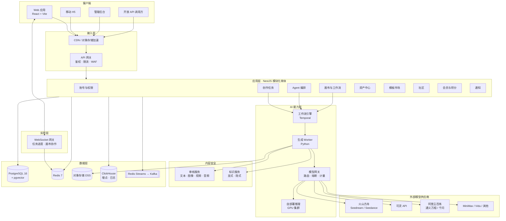
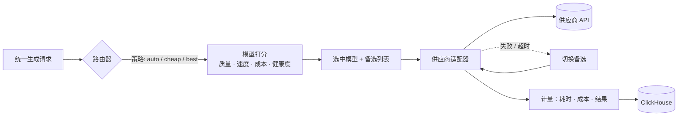
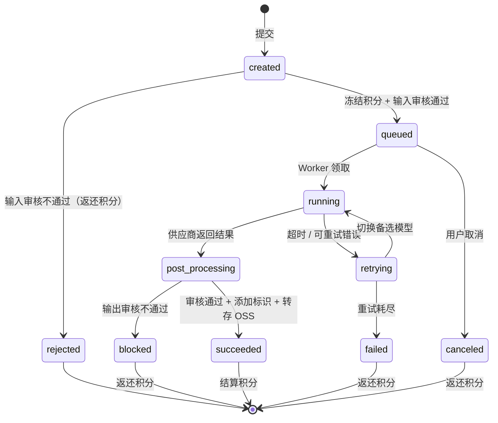
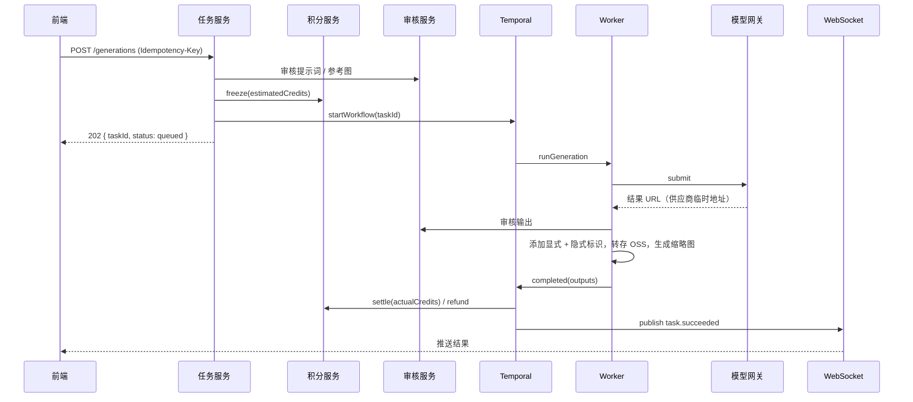
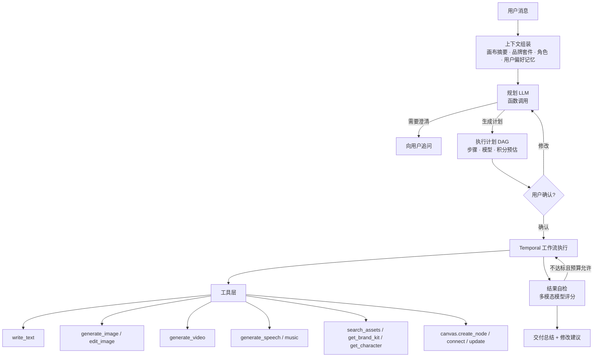
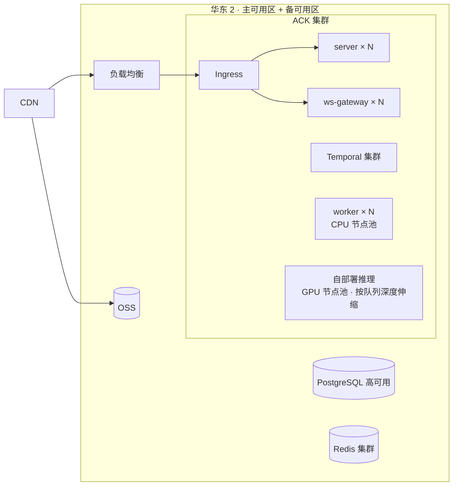

# 03 · 技术架构设计

> 关联文档：[02 PRD](./02-prd.md) · [04 数据库设计](./04-database.md) · [05 API 设计](./05-api.md) · [08 合规](./08-compliance.md)

## 1. 架构原则

1. **模型无关**：业务层只依赖统一的"生成能力接口"，任何供应商都可以通过适配器接入或替换。
2. **任务驱动**：所有生成都是异步任务，有明确的状态机、幂等键和补偿逻辑。
3. **账务优先正确**：积分采用"冻结 → 结算 / 返还"的复式记账，任何异常都可对账。
4. **合规内建**：审核与标识是任务流水线中的固定环节，不能被业务代码跳过。
5. **先单体后拆分**：MVP 采用"模块化单体 + 独立 Worker"，按负载和团队规模再拆服务，避免过早微服务化。

## 2. 总体架构



## 3. 技术选型

| 层 | 选型 | 理由 |
|---|---|---|
| 前端框架 | React 19 + TypeScript + Vite | 生态成熟，原型已采用，可直接演进 |
| SSR / SEO 页面 | Next.js（灵感广场、作品详情、模板详情） | 社区页面需要被搜索引擎收录 |
| 状态管理 | Zustand（本地状态）+ TanStack Query（服务端状态） | 轻量，适合工作台类复杂交互 |
| 画布 | React Flow（@xyflow/react）+ 自研节点 | 节点 / 连线 / 缩放 / 小地图开箱即用 |
| 协作 | Yjs + y-websocket（CRDT） | 画布多人编辑与离线合并 |
| UI 组件 | Radix UI 基础组件 + 自有设计令牌（见 06） | 无障碍、可定制 |
| BFF / 业务 | Node.js 22 + NestJS 11 | 与前端同语言，模块化单体易拆分 |
| AI Worker | Python 3.12 + FastAPI + 供应商 SDK | 生态最好，便于接入 ComfyUI / Diffusers |
| 工作流 | Temporal | 长时任务、重试、补偿、人工确认等待，天然适合 Agent 多步执行 |
| 消息 | Redis Streams（MVP）→ Kafka（日任务 > 200 万后） | 先简单后扩展 |
| 主库 | PostgreSQL 16 + pgvector | 关系数据 + 向量检索（语义搜索、相似作品）一库搞定 |
| 缓存 / 计数 | Redis 7 Cluster | 会话、限流、排队位置、热点计数 |
| 分析 | ClickHouse | 埋点、生成日志、成本分析 |
| 对象存储 | 阿里云 OSS（国内）/ S3 兼容 | 生成结果、上传素材；私有读 + 签名 URL |
| 搜索 | PostgreSQL 全文 + pgvector（MVP）→ OpenSearch（规模化后） | — |
| LLM（Agent / 写作） | 通义千问、豆包、DeepSeek 等国内已备案模型；海外版可接 Claude | 必须使用已备案模型提供国内服务 |
| 部署 | Kubernetes（阿里云 ACK）+ Helm + Argo CD | GPU 节点池弹性伸缩 |
| 观测 | OpenTelemetry + Prometheus + Grafana + Loki + Sentry | 全链路追踪生成任务 |
| CI/CD | GitHub Actions | lint · test · build · 镜像 · 部署 |

## 4. 代码仓库结构（Monorepo）

目标结构如下，标注 ✅ 的部分已在 Sprint 1 建立：

```text
creature/
├── apps/
│   ├── web/                # ✅ 用户端（React + Vite），由交互原型演进而来，保留离线演示模式
│   ├── server/             # ✅ NestJS 模块化单体（API + SSE + 进程内 Worker）
│   ├── site/               # SEO 页面（Next.js）
│   ├── admin/              # 管理后台
│   └── worker/             # Python 生成 Worker（接入自部署模型时拆出）
├── packages/
│   ├── shared/             # ✅ 共享类型、模型目录、积分价目、智能路由
│   ├── ui/                 # 设计令牌与基础组件
│   ├── sdk/                # 前端 API SDK（由 OpenAPI 生成）
│   └── canvas-core/        # 画布数据模型、拓扑排序、校验
├── infra/                  # helm / terraform / docker
├── .github/workflows/      # ✅ CI：类型检查、测试（PGlite + PostgreSQL）、构建
└── docs/                   # 本目录
```

工具链：当前使用 npm workspaces（包数量少，零额外依赖）；包数量增多后再引入 pnpm + Turborepo 的增量构建与缓存。Python 部分用 uv 管理依赖。

## 5. 核心模块设计

### 5.1 模型网关（Model Gateway）

**职责**：统一接口、供应商适配、智能路由、熔断降级、成本计量、配额控制。



**统一请求结构**（TypeScript 描述）：

```ts
type Modality = 'image' | 'video' | 'text' | 'speech' | 'music';

interface GenerationRequest {
  taskId: string;               // 幂等键
  modality: Modality;
  operation: 'generate' | 'edit' | 'upscale' | 'extend' | 'lipsync';
  prompt?: string;
  negativePrompt?: string;
  references?: Array<{ url: string; role: 'style' | 'subject' | 'character' | 'first_frame' | 'last_frame' | 'mask' }>;
  params: {
    aspectRatio?: string;       // '3:4'
    resolution?: '1k' | '2k' | '4k' | '720p' | '1080p';
    count?: number;
    durationSec?: number;
    nativeAudio?: boolean;
    camera?: { motion: string; strength: number };
    seed?: number;
  };
  routing: { strategy: 'auto' | 'cheap' | 'best'; pinnedModel?: string };
}

interface ProviderAdapter {
  readonly provider: string;
  supports(model: string, req: GenerationRequest): boolean;
  submit(model: string, req: GenerationRequest): Promise<{ vendorJobId: string }>;
  poll(vendorJobId: string): Promise<VendorJobStatus>;   // 不支持回调的供应商使用轮询
  parseCallback?(payload: unknown): VendorJobStatus;      // 支持回调的供应商
  estimateCost(model: string, req: GenerationRequest): { credits: number; vendorCostCny: number };
}
```

**路由打分**：

```text
score(model) = w_q · quality(model, taskFeatures)
             + w_s · speed(model)
             + w_c · (1 - normalizedCost(model))
             + w_h · health(model)          // 近 5 分钟成功率与 P95 耗时
```

- `taskFeatures` 由规则 + 轻量分类器提取（是否含中文文字、人像、动漫、产品图、写实等）。
- 三种策略对应不同权重组合，权重和模型基础分在后台可调，并支持 A/B 实验。
- 健康度低于阈值（如 5 分钟成功率 < 85%）的模型自动熔断 5 分钟。

**接入的模型（初版建议）**：

| 能力 | 主力 | 备选 / 低成本 |
|---|---|---|
| 图像 | Seedream（火山方舟）、通义万相 | 自部署开源模型（Flux / Qwen-Image 等，按许可证选择） |
| 视频 | Seedance、Kling 3.0 | 通义万相 Wan、海螺、Vidu、自部署 Wan |
| 写作 / Agent | 通义千问、豆包、DeepSeek | — |
| 语音 | 火山 / 阿里 / MiniMax TTS | — |
| 音乐 | 国内已备案音乐模型 | — |

> 国内服务只能调用已完成备案的模型，并在产品中公示模型名称与备案号，见 [08 合规](./08-compliance.md)。

### 5.2 生成任务生命周期



**时序**：



**关键设计**：
- **幂等**：客户端为每次提交生成 `Idempotency-Key`，服务端以 `(user_id, key)` 唯一约束去重，24 小时内重复提交返回同一任务。
- **优先级队列**：按套餐分 `p0`（企业 / 专业）`p1`（基础）`p2`（免费）三个队列；免费队列在高峰期限流，并展示排队位置。
- **超时**：图像 120 s、视频 15 min、文本 60 s；超时视为可重试错误。
- **供应商临时 URL**：一律在 Worker 内转存到自有 OSS，避免链接过期，也便于统一加标识。

### 5.3 积分账务

采用**复式记账 + 冻结**模型：

| 操作 | 可用余额 | 冻结余额 | 流水 |
|---|---|---|---|
| 充值 / 订阅发放 | + | | `grant` |
| 提交任务 | − 预估值 | + 预估值 | `freeze` |
| 任务成功 | | − 预估值 | `settle`（实际值）+ `unfreeze`（差额退回可用） |
| 任务失败 / 拦截 | + 预估值 | − 预估值 | `refund` |
| 积分过期 | − | | `expire` |

- 积分按"批次"（`credit_grants`）存储，每个批次有来源和有效期，扣减时按"先过期先扣"顺序拆分到多个批次。
- 所有变更在同一数据库事务内写入 `credit_ledger`，余额字段用 `version` 乐观锁。
- 每日对账任务：`Σ ledger = account.balance`、`Σ 供应商账单 ≈ Σ 任务 vendor_cost`，差异告警。

### 5.4 画布与工作流

**画布文档结构**（存储为 Yjs 文档，定期快照为 JSON）：

```ts
interface CanvasDoc {
  id: string;
  viewport: { x: number; y: number; zoom: number };
  nodes: Array<{
    id: string;
    type: 'text' | 'image_gen' | 'image_edit' | 'video_gen' | 'speech' | 'music' | 'character' | 'brand' | 'note' | 'group';
    position: { x: number; y: number };
    data: {
      params: Record<string, unknown>;     // 节点参数
      outputs?: Array<{ assetId: string }>;
      status: 'draft' | 'queued' | 'running' | 'succeeded' | 'failed' | 'stale';
      lastTaskId?: string;
    };
  }>;
  edges: Array<{ id: string; source: string; sourceHandle: string; target: string; targetHandle: string }>;
}
```

**执行**：
1. 前端提交"运行"请求（节点 ID 列表）。
2. 服务端读取最新快照，做拓扑排序与环检测，计算积分预估。
3. 启动 Temporal 工作流，按依赖层级并发执行；每个节点就是一个普通生成任务（复用 5.2）。
4. 节点完成后把输出写回 Yjs 文档，所有协作者实时看到。

**协作**：y-websocket 服务按画布 ID 分房间；每 30 秒或 200 次更新写一次快照到 PostgreSQL（JSONB）+ OSS（大文档）。

### 5.5 创作 Agent「小造」



**要点**：
- **计划即数据**：Planner 输出结构化 JSON（步骤、依赖、参数、模型、积分），前端渲染为可编辑的计划卡片，确认后才落到画布并执行。
- **预算护栏**：每次执行带积分上限；自检重试只在剩余预算内进行，并计入预估。
- **人在回路**：Temporal 的 Signal 机制用于"等待用户确认"，会话可中断后恢复。
- **记忆**：短期记忆 = 会话消息 + 画布摘要；长期记忆 = 用户偏好条目（`agent_memories` 表，用户可查看删除）。
- **Skill 对外开放（P2）**：把工具层以 MCP / HTTP Skill 形式开放给外部 Agent。

### 5.6 一致性能力

| 场景 | 实现 |
|---|---|
| 角色一致 | 优先使用供应商主体参考 / 多参考图接口；不支持时退化为"参考图 + 角色描述提示词"；专业版可训练角色 LoRA（自部署模型） |
| 产品一致 | 产品抠图 + 场景生成 + 光影融合（图像编辑链路） |
| 品牌一致 | 品牌套件注入：提示词约束（色彩、调性、禁用元素）+ 模板中 Logo 位自动放置 + 生成后色彩校验 |

角色参考图与特征向量存于 `characters` / `character_refs`，向量用于检索与一致性评分。

### 5.7 内容安全与标识

- **审核链**：提示词（关键词 + 文本审核模型）→ 上传素材（图像 / 视频 / 音频审核）→ 生成结果（同上）。采用"第三方审核服务 + 自建规则库 + 人工复核"三层。
- **标识服务**：
  - 显式：图像右下角"AI 生成"角标；视频起始画面与播放区域角标；音频起始语音提示；文本末尾提示。
  - 隐式：写入文件元数据（图像 EXIF / XMP、视频 / 音频容器元数据），字段按国标要求；同时可选 C2PA 清单（海外分发）。
- 标识在 Worker 后处理阶段统一完成，原始无标识文件只在内部存储桶保留，用户不可直接访问。

### 5.8 社区推荐（P1）

- 召回：热门（时间衰减热度）+ 关注 + 相似作品（pgvector 近邻）+ 标签。
- 排序：MVP 用规则加权（点赞、收藏、做同款次数、新鲜度）；数据积累后引入 CTR 模型。
- 发布到广场的作品需二次审核（机审 + 抽样人审）。

## 6. 部署架构



| 环境 | 用途 | 说明 |
|---|---|---|
| dev | 开发联调 | 模型网关默认使用 Mock 供应商，不消耗真实成本 |
| staging | 测试验收 | 接真实供应商，限额 |
| prod | 生产 | 双可用区，RDS 主备，每日全量 + 实时增量备份 |

**弹性策略**：
- server / ws：按 CPU 与连接数 HPA。
- worker：按 Redis Streams / Temporal 任务队列积压量伸缩（KEDA）。
- GPU 推理：按队列深度伸缩，空闲 10 分钟缩容；高峰期溢出到供应商 API。

## 7. 安全设计

| 方面 | 措施 |
|---|---|
| 认证 | JWT Access Token（2 h）+ Refresh Token（30 d，轮换 + 重用检测）；后台强制 MFA |
| 授权 | RBAC（平台角色）+ 资源级 ACL（团队 / 画布 / 资产） |
| 接口防护 | 网关限流（用户 + IP 维度）、WAF、验证码（异常行为触发） |
| 数据 | 手机号等敏感字段 AES-GCM 加密 + 哈希索引；OSS 私有读，签名 URL 有效期可配置（当前默认 2 小时，接入 CDN 后缩短） |
| 供应商密钥 | 存于云 KMS / Secrets Manager，Worker 运行时注入，不落库 |
| 支付 | 回调验签、金额与订单二次校验、幂等处理 |
| 审计 | 后台操作、积分调整、权限变更全部写入审计日志（只追加） |
| 滥用防护 | 新号限额、设备指纹、批量注册检测、异常消耗告警 |

## 8. 可观测性

- **Trace**：一个生成任务从提交到结算的全链路使用同一 `trace_id`（OpenTelemetry），跨 API、Temporal、Worker、供应商调用。
- **核心指标**：任务提交 QPS、排队时长、各模型成功率与 P50/P95 耗时、供应商错误码分布、单任务成本、积分冻结余额。
- **告警**：模型成功率 < 90%（5 分钟）、队列积压 > 阈值、支付回调失败、对账差异。

## 9. 开发规范

- **分支**：trunk-based，`main` 受保护；功能分支 + PR + 至少 1 人评审。
- **提交信息**：Conventional Commits（`feat:` `fix:` `docs:` …）。
- **测试**：单元测试（积分计算、路由打分、拓扑排序覆盖率 ≥ 90%）+ 接口集成测试（使用 Mock 供应商）+ 关键路径 E2E（Playwright：登录 → 生成 → 下载 → 支付）。
- **接口契约**：OpenAPI 3.1 为唯一事实来源，自动生成前端 SDK 与后端 DTO 校验。
- **特性开关**：新模型、新功能全部经由特性开关灰度发布。

## 10. 当前实现

Sprint 1 交付了可运行的后端与接入真实接口的用户端；Sprint 2 补上素材上传、参考图（图生图 / 图生视频 / 首尾帧）与画布持久化；Sprint 3 补上作品库文件夹与下载、灵感广场（发布、点赞、做同款、举报）和管理后台 v1；Sprint 4 补上图像编辑（局部重绘、扩图、消除、抠图、超分）与后台用户管理；Sprint 5 完成上线准备：staging 环境与容器镜像、监控指标、限流防刷、定时对账与压测（见 [09 上线准备](./09-launch-readiness.md)）；Sprint 6 让后端可以多实例部署：跨实例推送、账号状态广播、按数据库计数的限流与迁移加锁；Sprint 7 补上 S3 兼容对象存储驱动（浏览器直传）与 Worker 容量改造（按模态的并发槽位、停机重新排队）；Sprint 8 补上角色库与品牌套件（专业版功能）及生成时引用。以下是实现与目标架构的对应关系，以及有意做出的阶段性取舍。

### 10.1 已实现

| 模块 | 位置 | 说明 |
|---|---|---|
| 数据访问 | `apps/server/src/db` | 同一套 SQL 运行在 PostgreSQL（`DATABASE_URL`）或内嵌 PGlite 上；启动时在一个事务内持有咨询锁、按文件顺序执行尚未执行的 `migrations/*.sql`（多个实例同时启动只执行一次）；PostgreSQL 下提供 `LISTEN / NOTIFY`（专用连接，断开后持续重连） |
| 账号 | `src/auth` | 验证码登录（60 秒 / 每日 10 次限流，5 次错误失效）；手机号 AES-256-GCM 加密 + HMAC 索引；访问令牌 2 小时，刷新令牌放 httpOnly Cookie，轮换并检测重用（重用时吊销整个令牌族），每人最多 5 个会话 |
| 积分账务 | `src/credits` | 批次 + 冻结明细 + 只追加流水，见 5.3；加锁顺序固定为"先账户、后批次"；`reconcile()` 四方对账 |
| 模型网关 | `src/gateway` | 统一请求、路由、最多 3 个候选模型依次尝试、5 分钟窗口成功率低于 85% 熔断 5 分钟；按模态设置超时 |
| 生成任务 | `src/generations` | 幂等创建（`Idempotency-Key`，重放返回 200，内容不同返回 409）；按套餐进入 p0/p1/p2 队列；Worker 用 `FOR UPDATE SKIP LOCKED` 按各模态的空闲槽位认领，任务结束即补位；每次状态变更都校验尝试次数，防止被回收或停机重新排队的旧尝试覆盖结果；停机时超过宽限期的任务重新排队；排队位置按模态计数并设上限 |
| 内容安全 | `src/safety` | 提示词与生成结果两道审核并留痕；显式标识（SVG 角标、WAV 开头提示音、文本末尾提示语）+ 隐式标识（SVG metadata、WAV INFO 块、数据库内容编号） |
| 文件 | `src/storage`、`src/assets` | 交付文件与原始文件分开存放；签名地址（HMAC，默认 2 小时有效）。两种驱动：本地目录（响应带 `sandbox` CSP，SVG 无法执行脚本）与 S3 兼容对象存储（自行实现 Signature V4；`/v1/files` 校验签名后跳转到预签名读取地址） |
| 素材上传 | `src/assets/uploads.service.ts` | 三步上传：创建会话（校验类型 PNG / JPEG / WebP、≤ 20 MB、每日 200 次）→ PUT 到 15 分钟有效的签名地址（流式写入、超出声明大小即中断、按文件头识别格式与尺寸，与声明不符拒收）→ 完成（上传审核通过后生成资产，重复调用幂等）。对象存储驱动下浏览器直传到存储桶（大小与类型参与签名），文件头在完成时校验。上传素材 `source = uploaded`，不加 AI 标识 |
| 参考图 | `src/generations`、`src/gateway` | `references: [{ asset_id, role }]`，最多 4 张：图像支持 `style` / `subject` / `character`，视频支持 `first_frame` / `last_frame`（各至多 1 张）；只能引用自己的图像资产，校验在冻结积分之前完成；Worker 读取原始文件传给供应商适配器，计价不变 |
| 项目与画布 | `src/canvases` | 画布文档（节点、连线、小造对话、视口）整体保存为 `jsonb`，PUT 必须带读取时的版本号，不一致返回 `409 CANVAS_VERSION_CONFLICT`；节点只存 `taskId`，读取时按任务补全状态与签名产物地址（地址不落库）；文档上限 1 MB / 500 节点 |
| 作品库 | `src/assets` | 文件夹（每人 50 个、重名 409、删除后作品移回未归档）、批量移动；下载地址 10 分钟有效，文件名参与签名并以附件返回，生成作品下载的是带显式与隐式标识的交付文件 |
| 灵感广场 | `src/community` | 只能发布自己的 AI 生成图像 / 视频，发布时快照提示词与参数；机审拦截 / 复核两档；推荐排序为互动数按发布时长衰减；点赞与做同款按人去重；累计 3 人举报自动隐藏；删除作品时同时撤回 |
| 图像编辑 | `src/generations`、`src/gateway` | 作为 `operation = edit` 的图像任务走同一条队列与账务链路；固定由编辑模型处理（不参与生成路由、不切换备选）；涂抹区域以私有文件保存，Worker 连同源图原始文件一起交给适配器；结果同样审核并加标识 |
| 角色库与品牌套件 | `src/library`、`packages/shared/src/library.ts` | 专业版 / 团队版按配额使用（其他套餐 `403 PLAN_FEATURE_REQUIRED`）；角色为 3–8 张本人图像资产 + 设定 + 肖像声明（他人肖像须附授权材料）；品牌套件为标准色、字体、调性、禁用元素与 Logo；文字过审。生成请求的 `context` 在冻结积分前校验，并以快照随任务保存；Worker 按快照取每个角色 3 张参考图（按视角优先级）与主 Logo 传给适配器，`composePrompt` 把角色设定与品牌规范附加在发给模型的提示词后（任务记录保留原始提示词），注入后的提示词整体过审 |
| 管理后台 | `src/admin` | `ADMIN_PHONES` 登录授予管理员，每次请求查库校验；运营概览（按北京时间）、模型健康度（网关窗口 + 近 24 小时任务 P95）、广场复核队列；用户查询、冻结 / 封禁 / 解除（吊销会话）、人工调整积分（`adjust` 流水，可对账）；所有处理写人工审核记录或只追加的审计日志 |
| 订单 | `src/billing` | 积分包与订阅；年付按月发放；订阅积分可结转一个周期；到期自动降级 |
| 运维 | `src/observability`、`src/credits/reconcile.service.ts`、`deploy/` | `/v1/metrics`（按路由模板聚合的请求计数与耗时、任务、模型、对账指标）、访问日志、安全响应头；生成提交按用户限流；定时全量对账（集合查询，写 `reconcile_runs`）；`APP_ENV=staging` 模式；后端 / 用户端镜像与 staging 编排 |
| 推送 | `GET /v1/events`、`src/events` | SSE 推送任务进度与积分变化（EventSource 通过查询参数携带访问令牌）；事件总线经 PostgreSQL `LISTEN / NOTIFY` 在实例之间转发（任务内容随通知发送，过大时传引用），并承载账号状态变更等控制消息；监听重连后发出 `sync` 让客户端补齐 |
| 前端 | `apps/web` | 登录、工作台（含参考图上传与用途切换、首尾帧、做同款预填参数与模型）、资产库（上传、文件夹、移动、下载、分页）、灵感广场（推荐 / 最新 / 最热 / 我的发布、点赞、举报、撤回）、发布到广场、画布、项目页、会员积分、管理后台（仅管理员可见）接入真实接口；`VITE_BACKEND=mock` 时为离线演示 |

### 10.2 阶段性取舍

| 目标架构 | 当前实现 | 何时切换 |
|---|---|---|
| Temporal 编排 + Python Worker | 进程内 Worker，以数据库为队列（可多实例并行认领） | 接入自部署 GPU 模型或 Agent 多步执行需要人工确认等待时 |
| WebSocket | SSE（单向推送已满足需求，实现与代理配置更简单） | 画布多人协作（Yjs）上线时引入 WebSocket |
| UUIDv7 主键 | 带类型前缀、按时间有序的文本主键 | 无需切换；对外 ID 格式与文档一致 |
| 生成任务按月分区 | 普通表 + 部分索引 | 日任务量超过百万级时 |
| 对象存储 | 已实现 S3 兼容驱动（MinIO 验证）；缩略图、未完成上传的文件清理、删除作品时删除文件尚未实现 | 接入 OSS / COS 账号后在 staging 验证跨域与独立域名；清理任务在上线前完成 |
| 第三方内容审核 | 关键词规则（打通流程与留痕）；上传素材目前只检查文件名，没有做图像审核；广场发布的复核词为示例规则 | 公开内测前，必须完成 |
| 广场推荐 | SQL 排序（互动数按时间衰减），偏移量分页 | 有足够行为数据后换成召回 + 排序服务，分页改为游标快照 |
| 角色一致性 | 角色参考图随请求传给模型（主体参考接口）；Mock 供应商把角色参考图放进画面 | 专业版角色 LoRA 训练（`/characters/{id}/train`，60 积分）在接入自部署图像模型后实现 |
| 品牌 Logo 放置 | Logo 作为参考图传给模型并在提示词中要求放在右上角；Mock 供应商直接合成到画面中 | 真实供应商的输出为位图，需要在后处理中合成 Logo（图像处理库），接入供应商时实现 |
| 后台模型管理 | 只读展示健康度；启停与路由权重仍由配置与熔断决定 | 接入真实供应商后加入运营可调的权重与开关（写审计日志） |
| Redis（会话、限流、排队位置、推送分发） | 不引入：账号状态为实例内缓存 + 事件总线广播失效；提交限流按数据库计数；推送分发用 PostgreSQL `LISTEN / NOTIFY` | 通知量继续增长出现瓶颈（压测中约每秒 600 条通知，未见瓶颈；`NOTIFY` 在提交时需要全局串行）或需要持久化的消息时，换成 Redis Pub/Sub / Streams |
| 图像编辑供应商 | Mock 供应商用 SVG 合成编辑效果（遮罩重绘、模糊补全、羽化抠图、放大） | 接入自部署编辑模型（如 SD Inpaint、抠图与超分模型）或供应商编辑接口 |
| 真实模型供应商 | Mock 供应商按提示词确定性地生成 SVG / WAV / 文本文件；`PROVIDER_MODE=live` 时未接入适配器的模型自动停用 | 拿到供应商测试账号后逐家接入 |
| 短信 / 支付 | 开发模式验证码、模拟支付；生产配置下未接入时拒绝启动 | 上线前 |
| 画布快照与协作 | 每个画布一份文档 + 版本号乐观锁（不保留历史快照）；两个窗口同时编辑时后保存的一方载入最新版本 | 多人协作（Yjs + `canvas_snapshots`）在 Beta 后期上线 |
| 画布运行（`/canvases/{id}/runs`） | 前端按依赖顺序逐个提交生成任务，服务端只保存节点与任务的关联 | 小造需要在服务端代为执行长流程时 |

### 10.3 测试

- `packages/shared`：计价与价目表一致性、路由规则、参数规范化、角色与品牌规范注入（30 项）。
- `apps/server`：积分账务（含 60 步随机操作后的对账）、标识、网关降级与熔断，以及覆盖登录、生成全链路、幂等、返还、并发、卡死回收、订单、上传（签名、过期、格式伪造、超限、审核拒绝）、参考图（图生图、首帧驱动视频、非法引用不冻结积分）、画布（版本冲突、产物不落库、校验与越权）、作品库（文件夹、移动、下载签名）、灵感广场（发布规则、点赞幂等、隐藏提示词、做同款计数、分页、举报自动隐藏）、管理后台（权限、概览、模型统计、复核与审计）、图像编辑（五种工具的参数校验、遮罩、计价、标识、失败返还）、用户管理（查询、积分调整与对账、冻结后令牌与登录失效）、上线准备（安全响应头、指标与令牌、按用户限流、对账发现篡改与残留冻结、配置模式）的接口集成测试，以及事件总线的跨实例广播规则、S3 签名（AWS 公开示例）、Worker 槽位与停机重新排队、排队位置、角色库与品牌套件（套餐权益、校验、配额、快照、注入后的提示词与参考图、到期后的权限）（共 93 项）；另有 7 项多实例测试只在 PostgreSQL 上运行（跨实例推送与积分变化、长提示词传引用、监听断开重连与数据库暂时不可达、账号冻结立即生效、限流额度共享、并发迁移），5 项对象存储测试在设置 `TEST_S3_ENDPOINT` 时运行（CI 中为 MinIO）。
- 浏览器端到端（Playwright，真实后端 + API 模式前端）：上传参考图并切换用途 → 图生图；首尾帧生成视频；资产库上传；画布自动保存、刷新恢复、修改后保留旧产物、两窗口冲突；项目新建 / 打开 / 删除；工作流模板生成新项目；文件夹整理与下载、发布（含人工复核）、他人点赞 / 做同款 / 举报、管理员复核后广场内容变化、非管理员无法进入后台；图像编辑器在图上涂抹后局部重绘、对结果继续超分 / 扩图 / 消除 / 抠图；管理员调整积分后用户余额实时更新、冻结后用户被退回登录页；staging 两个后端实例下，nginx 中断期间完成的任务在恢复后补齐、滚动重启时保持登录；免费版看到升级提示 → 模拟支付升级专业版 → 上传参考图新建两个角色、新建带 Logo 的品牌套件 → 图像工作台引用两个角色与品牌套件并放置 Logo（结果中有两个角色、Logo 与品牌色）→ 从角色卡进入工作台预选角色 → 写作引用品牌套件 → 编辑角色、删除品牌套件。
- 同一套后端测试分别在 PGlite 与 PostgreSQL 16 上运行（CI 两个任务）。真实 PostgreSQL 上的并发测试曾暴露出"插入任务（外键 KEY SHARE 锁）后再锁账户（FOR UPDATE）"导致的死锁，已调整为先冻结再插入，并为事务增加死锁重试。

