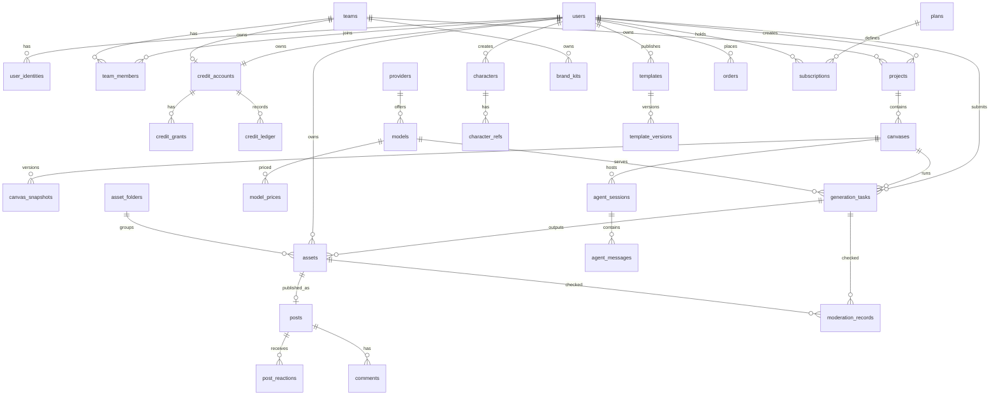

# 04 · 数据库设计

> 数据库：PostgreSQL 16（主库）· Redis 7（缓存 / 计数）· ClickHouse（分析）
> 关联文档：[03 技术架构](./03-architecture.md) · [05 API 设计](./05-api.md)

> **实现说明**：MVP 已落地的表结构见 [`apps/server/migrations/001_init.sql`](../apps/server/migrations/001_init.sql)，覆盖账号、会话、验证码、积分（账户 / 批次 / 冻结明细 / 流水）、生成任务、资产、审核记录、订单与订阅。与本文的差异：主键使用带类型前缀、按时间有序的文本 ID；积分与金额用 `integer`；生成任务暂未分区；新增 `credit_holds`（记录冻结扣自哪些批次，用于精确退回）与 `sms_codes`、`auth_sessions`。其余表随对应功能迁移加入：[`002_uploads.sql`](../apps/server/migrations/002_uploads.sql) 新增 `uploads`（上传会话）、`assets.source`（generated / uploaded）与 `generation_tasks.input_refs`（参考图）；[`003_canvases.sql`](../apps/server/migrations/003_canvases.sql) 新增 `projects` 与 `canvases`——画布文档直接存在 `canvases.doc`（`jsonb`）并用 `version` 做乐观锁，暂不建 `canvas_snapshots`（多人协作上线时再加）。[`004_community.sql`](../apps/server/migrations/004_community.sql) 新增 `asset_folders` 与 `assets.folder_id`、`posts`（发布时快照提示词与参数，`report_count` 用于自动隐藏）、`post_likes`、`post_remixes`（做同款按人计数）、`reports`、`audit_logs`，以及 `users.role` 与审核记录的 `stage` / `reviewer_id`（区分机审与人工复核）。[`005_image_edit.sql`](../apps/server/migrations/005_image_edit.sql) 为生成任务增加 `mask_key`（图像编辑的涂抹区域，私有文件）；[`006_reconcile.sql`](../apps/server/migrations/006_reconcile.sql) 新增 `reconcile_runs`（定期全量对账记录）。评论、团队、模板等表尚未加入。

## 1. 设计约定

- 主键：`uuid`（UUIDv7，按时间有序，利于索引局部性），对外暴露时加类型前缀（如 `tsk_`、`ast_`）。
- 时间：统一 `timestamptz`，存 UTC。
- 软删除：业务表使用 `deleted_at`；账务表**禁止删除和更新金额**，只追加。
- 金额：人民币以"分"为单位存 `bigint`；积分存 `bigint`。
- 枚举：使用 `text` + `CHECK` 约束，便于迁移。
- 命名：表名复数蛇形，外键 `<entity>_id`。
- 迁移工具：Prisma Migrate 或 Atlas，所有变更走评审。

## 2. 实体关系图



## 3. 表结构

### 3.1 账号与团队

```sql
CREATE TABLE users (
  id              uuid PRIMARY KEY,
  nickname        text NOT NULL,
  avatar_url      text,
  phone_enc       bytea,                       -- AES-GCM 加密
  phone_hash      text UNIQUE,                 -- HMAC-SHA256，用于查找
  status          text NOT NULL DEFAULT 'active' CHECK (status IN ('active','frozen','banned','deleted')),
  is_minor_mode   boolean NOT NULL DEFAULT false,
  plan_code       text NOT NULL DEFAULT 'free', -- 冗余当前套餐，便于路由队列判断
  created_at      timestamptz NOT NULL DEFAULT now(),
  updated_at      timestamptz NOT NULL DEFAULT now(),
  deleted_at      timestamptz
);

CREATE TABLE user_identities (
  id              uuid PRIMARY KEY,
  user_id         uuid NOT NULL REFERENCES users(id),
  provider        text NOT NULL CHECK (provider IN ('phone','wechat','apple','email')),
  provider_uid    text NOT NULL,
  created_at      timestamptz NOT NULL DEFAULT now(),
  UNIQUE (provider, provider_uid)
);

CREATE TABLE teams (
  id              uuid PRIMARY KEY,
  name            text NOT NULL,
  owner_id        uuid NOT NULL REFERENCES users(id),
  seat_limit      int  NOT NULL DEFAULT 3,
  created_at      timestamptz NOT NULL DEFAULT now(),
  deleted_at      timestamptz
);

CREATE TABLE team_members (
  team_id         uuid NOT NULL REFERENCES teams(id),
  user_id         uuid NOT NULL REFERENCES users(id),
  role            text NOT NULL CHECK (role IN ('owner','admin','member','guest')),
  monthly_credit_cap bigint,                   -- 成员月度积分上限，NULL 表示不限
  joined_at       timestamptz NOT NULL DEFAULT now(),
  PRIMARY KEY (team_id, user_id)
);
```

### 3.2 积分与账务

```sql
-- 账户：个人或团队各一个
CREATE TABLE credit_accounts (
  id              uuid PRIMARY KEY,
  owner_type      text NOT NULL CHECK (owner_type IN ('user','team')),
  owner_id        uuid NOT NULL,
  available       bigint NOT NULL DEFAULT 0 CHECK (available >= 0),
  frozen          bigint NOT NULL DEFAULT 0 CHECK (frozen >= 0),
  version         bigint NOT NULL DEFAULT 0,   -- 乐观锁
  updated_at      timestamptz NOT NULL DEFAULT now(),
  UNIQUE (owner_type, owner_id)
);

-- 积分批次：每次发放一条，记录来源与有效期
CREATE TABLE credit_grants (
  id              uuid PRIMARY KEY,
  account_id      uuid NOT NULL REFERENCES credit_accounts(id),
  source          text NOT NULL CHECK (source IN ('daily','signup','subscription','pack','refund_comp','template_share','admin')),
  amount          bigint NOT NULL CHECK (amount > 0),
  remaining       bigint NOT NULL CHECK (remaining >= 0),
  expires_at      timestamptz NOT NULL,
  ref_id          uuid,                        -- 订单 / 订阅 / 活动
  created_at      timestamptz NOT NULL DEFAULT now()
);
CREATE INDEX idx_grants_consume ON credit_grants (account_id, expires_at) WHERE remaining > 0;

-- 流水：只追加
CREATE TABLE credit_ledger (
  id              bigserial PRIMARY KEY,
  account_id      uuid NOT NULL REFERENCES credit_accounts(id),
  entry_type      text NOT NULL CHECK (entry_type IN ('grant','freeze','settle','unfreeze','refund','expire','adjust')),
  delta_available bigint NOT NULL,
  delta_frozen    bigint NOT NULL,
  balance_after   bigint NOT NULL,
  task_id         uuid,
  grant_id        uuid,
  operator_id     uuid,                        -- 人工调整时记录操作人
  idempotency_key text,
  memo            text,
  created_at      timestamptz NOT NULL DEFAULT now(),
  UNIQUE (account_id, idempotency_key)
);
CREATE INDEX idx_ledger_account_time ON credit_ledger (account_id, created_at DESC);
```

### 3.3 订阅与订单

```sql
CREATE TABLE plans (
  code            text PRIMARY KEY,            -- free / basic / pro / team / enterprise
  name            text NOT NULL,
  price_month_fen bigint NOT NULL,
  price_year_fen  bigint NOT NULL,
  monthly_credits bigint NOT NULL,
  queue_priority  smallint NOT NULL,           -- 0 最高
  features        jsonb NOT NULL,              -- {"commercial":true,"max_resolution":"4k",...}
  is_active       boolean NOT NULL DEFAULT true
);

CREATE TABLE subscriptions (
  id              uuid PRIMARY KEY,
  owner_type      text NOT NULL CHECK (owner_type IN ('user','team')),
  owner_id        uuid NOT NULL,
  plan_code       text NOT NULL REFERENCES plans(code),
  cycle           text NOT NULL CHECK (cycle IN ('month','year')),
  status          text NOT NULL CHECK (status IN ('active','past_due','canceled','expired')),
  current_period_start timestamptz NOT NULL,
  current_period_end   timestamptz NOT NULL,
  auto_renew      boolean NOT NULL DEFAULT true,
  created_at      timestamptz NOT NULL DEFAULT now()
);

CREATE TABLE orders (
  id              uuid PRIMARY KEY,
  order_no        text NOT NULL UNIQUE,
  user_id         uuid NOT NULL REFERENCES users(id),
  item_type       text NOT NULL CHECK (item_type IN ('subscription','credit_pack','seat')),
  item_ref        text NOT NULL,
  amount_fen      bigint NOT NULL,
  pay_channel     text CHECK (pay_channel IN ('wechat','alipay','bank_transfer')),
  status          text NOT NULL CHECK (status IN ('pending','paid','refunding','refunded','closed')),
  channel_txn_id  text,
  paid_at         timestamptz,
  created_at      timestamptz NOT NULL DEFAULT now()
);
```

### 3.4 模型与供应商

```sql
CREATE TABLE providers (
  code            text PRIMARY KEY,            -- volcengine / kling / bailian / minimax / self_hosted
  name            text NOT NULL,
  status          text NOT NULL DEFAULT 'active',
  config          jsonb NOT NULL DEFAULT '{}'  -- 端点、区域等（密钥不入库）
);

CREATE TABLE models (
  code            text PRIMARY KEY,            -- seedream-4 / kling-3.0 / wan-2.6 ...
  provider_code   text NOT NULL REFERENCES providers(code),
  display_name    text NOT NULL,
  modality        text NOT NULL CHECK (modality IN ('image','video','text','speech','music')),
  tier            text NOT NULL CHECK (tier IN ('standard','advanced','flagship')),
  capabilities    jsonb NOT NULL,              -- {"max_duration":15,"native_audio":true,"ratios":["16:9",...]}
  quality_score   numeric(4,2) NOT NULL,       -- 路由用基础分
  speed_score     numeric(4,2) NOT NULL,
  filing_no       text,                        -- 备案号 / 登记编号（公示用）
  is_enabled      boolean NOT NULL DEFAULT true,
  sort_order      int NOT NULL DEFAULT 0
);

CREATE TABLE model_prices (
  id              uuid PRIMARY KEY,
  model_code      text NOT NULL REFERENCES models(code),
  unit            text NOT NULL CHECK (unit IN ('image','second','1k_chars','track')),
  spec            jsonb NOT NULL,              -- {"resolution":"1080p","native_audio":false}
  credits         bigint NOT NULL,             -- 用户侧价格
  vendor_cost_fen bigint NOT NULL,             -- 平台成本（分），用于毛利分析
  effective_from  timestamptz NOT NULL,
  effective_to    timestamptz
);
```

### 3.5 创作任务

```sql
CREATE TABLE generation_tasks (
  id              uuid NOT NULL,
  user_id         uuid NOT NULL,
  team_id         uuid,
  account_id      uuid NOT NULL,
  canvas_id       uuid,
  canvas_node_id  text,
  agent_run_id    uuid,
  modality        text NOT NULL,
  operation       text NOT NULL,
  model_code      text NOT NULL,
  routing_strategy text NOT NULL DEFAULT 'auto',
  prompt          text,
  params          jsonb NOT NULL,
  input_refs      jsonb NOT NULL DEFAULT '[]',
  status          text NOT NULL CHECK (status IN ('created','queued','running','retrying','post_processing','succeeded','failed','blocked','canceled','rejected')),
  queue           text NOT NULL,               -- p0 / p1 / p2
  estimated_credits bigint NOT NULL,
  actual_credits  bigint,
  vendor_cost_fen bigint,
  vendor_job_id   text,
  attempt         smallint NOT NULL DEFAULT 0,
  error_code      text,
  error_message   text,
  idempotency_key text NOT NULL,
  trace_id        text,
  created_at      timestamptz NOT NULL DEFAULT now(),
  started_at      timestamptz,
  finished_at     timestamptz,
  PRIMARY KEY (id, created_at)
) PARTITION BY RANGE (created_at);              -- 按月分区，保留 12 个月热数据

CREATE INDEX idx_tasks_user_time ON generation_tasks (user_id, created_at DESC);
CREATE INDEX idx_tasks_status ON generation_tasks (status) WHERE status IN ('queued','running','retrying','post_processing');
CREATE UNIQUE INDEX idx_tasks_idem ON generation_tasks (user_id, idempotency_key, created_at);
```

> 分区表上的唯一索引必须包含分区键，因此幂等去重在应用层另用 Redis `SETNX idem:{user}:{key}`（TTL 24 h）兜底。

### 3.6 资产

```sql
CREATE TABLE asset_folders (
  id              uuid PRIMARY KEY,
  owner_type      text NOT NULL,
  owner_id        uuid NOT NULL,
  parent_id       uuid REFERENCES asset_folders(id),
  name            text NOT NULL,
  created_at      timestamptz NOT NULL DEFAULT now()
);

CREATE TABLE assets (
  id              uuid PRIMARY KEY,
  owner_type      text NOT NULL CHECK (owner_type IN ('user','team')),
  owner_id        uuid NOT NULL,
  creator_id      uuid NOT NULL REFERENCES users(id),
  folder_id       uuid REFERENCES asset_folders(id),
  source          text NOT NULL CHECK (source IN ('generated','uploaded','edited')),
  task_id         uuid,
  kind            text NOT NULL CHECK (kind IN ('image','video','audio','text')),
  storage_key     text NOT NULL,               -- 带标识的交付文件
  raw_storage_key text,                        -- 内部原始文件（不对外）
  thumb_key       text,
  mime_type       text NOT NULL,
  width           int,
  height          int,
  duration_ms     int,
  size_bytes      bigint NOT NULL,
  content_id      text NOT NULL,               -- 隐式标识中的内容编号
  tags            text[] NOT NULL DEFAULT '{}',
  embedding       vector(768),                 -- 语义检索
  is_favorite     boolean NOT NULL DEFAULT false,
  moderation      text NOT NULL DEFAULT 'pass' CHECK (moderation IN ('pending','pass','review','blocked')),
  expires_at      timestamptz,                 -- 未收藏作品 180 天后清理
  created_at      timestamptz NOT NULL DEFAULT now(),
  deleted_at      timestamptz
);
CREATE INDEX idx_assets_owner_time ON assets (owner_type, owner_id, created_at DESC) WHERE deleted_at IS NULL;
CREATE INDEX idx_assets_embedding ON assets USING hnsw (embedding vector_cosine_ops);
CREATE INDEX idx_assets_tags ON assets USING gin (tags);
```

### 3.7 角色与品牌

```sql
CREATE TABLE characters (
  id              uuid PRIMARY KEY,
  owner_type      text NOT NULL,
  owner_id        uuid NOT NULL,
  name            text NOT NULL,
  description     text,
  voice_id        text,
  lora_status     text NOT NULL DEFAULT 'none' CHECK (lora_status IN ('none','training','ready','failed')),
  lora_key        text,
  likeness_consent_asset_id uuid,              -- 真人肖像授权材料
  created_at      timestamptz NOT NULL DEFAULT now()
);

CREATE TABLE character_refs (
  id              uuid PRIMARY KEY,
  character_id    uuid NOT NULL REFERENCES characters(id),
  asset_id        uuid NOT NULL REFERENCES assets(id),
  view            text CHECK (view IN ('front','side','back','full_body','expression')),
  embedding       vector(768)
);

CREATE TABLE brand_kits (
  id              uuid PRIMARY KEY,
  owner_type      text NOT NULL,
  owner_id        uuid NOT NULL,
  name            text NOT NULL,
  logos           jsonb NOT NULL DEFAULT '[]', -- [{asset_id, variant:"light|dark|mono"}]
  colors          jsonb NOT NULL DEFAULT '[]', -- [{name, hex, role}]
  fonts           jsonb NOT NULL DEFAULT '[]',
  tone            text,
  banned_elements text[] NOT NULL DEFAULT '{}',
  created_at      timestamptz NOT NULL DEFAULT now()
);
```

### 3.8 项目、画布与 Agent

```sql
CREATE TABLE projects (
  id              uuid PRIMARY KEY,
  owner_type      text NOT NULL,
  owner_id        uuid NOT NULL,
  name            text NOT NULL,
  cover_asset_id  uuid,
  created_at      timestamptz NOT NULL DEFAULT now(),
  updated_at      timestamptz NOT NULL DEFAULT now(),
  deleted_at      timestamptz
);

CREATE TABLE canvases (
  id              uuid PRIMARY KEY,
  project_id      uuid NOT NULL REFERENCES projects(id),
  name            text NOT NULL,
  latest_snapshot_id uuid,
  share_mode      text NOT NULL DEFAULT 'private' CHECK (share_mode IN ('private','team','link_view','link_comment')),
  created_by      uuid NOT NULL REFERENCES users(id),
  created_at      timestamptz NOT NULL DEFAULT now(),
  updated_at      timestamptz NOT NULL DEFAULT now()
);

CREATE TABLE canvas_snapshots (
  id              uuid PRIMARY KEY,
  canvas_id       uuid NOT NULL REFERENCES canvases(id),
  doc             jsonb,                       -- 小文档直接存
  doc_storage_key text,                        -- 大文档存 OSS
  yjs_state       bytea,                       -- Yjs 编码状态
  node_count      int NOT NULL,
  created_by      uuid,
  created_at      timestamptz NOT NULL DEFAULT now()
);

CREATE TABLE agent_sessions (
  id              uuid PRIMARY KEY,
  canvas_id       uuid REFERENCES canvases(id),
  user_id         uuid NOT NULL REFERENCES users(id),
  status          text NOT NULL CHECK (status IN ('active','awaiting_confirm','executing','idle','closed')),
  workflow_id     text,                        -- Temporal workflow id
  created_at      timestamptz NOT NULL DEFAULT now()
);

CREATE TABLE agent_messages (
  id              uuid PRIMARY KEY,
  session_id      uuid NOT NULL REFERENCES agent_sessions(id),
  role            text NOT NULL CHECK (role IN ('user','assistant','tool','system')),
  content         jsonb NOT NULL,              -- 文本 / 计划卡片 / 工具调用与结果
  llm_model       text,
  input_tokens    int,
  output_tokens   int,
  created_at      timestamptz NOT NULL DEFAULT now()
);

CREATE TABLE agent_memories (
  id              uuid PRIMARY KEY,
  user_id         uuid NOT NULL REFERENCES users(id),
  kind            text NOT NULL CHECK (kind IN ('style','ratio','platform','brand','other')),
  content         text NOT NULL,
  created_at      timestamptz NOT NULL DEFAULT now()
);
```

### 3.9 模板与社区

```sql
CREATE TABLE templates (
  id              uuid PRIMARY KEY,
  author_id       uuid NOT NULL REFERENCES users(id),
  kind            text NOT NULL CHECK (kind IN ('single_step','workflow')),
  title           text NOT NULL,
  description     text,
  category        text NOT NULL,
  cover_asset_id  uuid,
  latest_version_id uuid,
  status          text NOT NULL CHECK (status IN ('draft','reviewing','listed','delisted')),
  is_official     boolean NOT NULL DEFAULT false,
  use_count       bigint NOT NULL DEFAULT 0,
  rating_avg      numeric(3,2),
  revenue_share_pct smallint NOT NULL DEFAULT 10,
  created_at      timestamptz NOT NULL DEFAULT now()
);

CREATE TABLE template_versions (
  id              uuid PRIMARY KEY,
  template_id     uuid NOT NULL REFERENCES templates(id),
  version         int NOT NULL,
  definition      jsonb NOT NULL,              -- 单步：参数 + 变量；工作流：节点与连线
  variables       jsonb NOT NULL DEFAULT '[]', -- 用户需填写的变量定义
  estimated_credits bigint NOT NULL,
  created_at      timestamptz NOT NULL DEFAULT now(),
  UNIQUE (template_id, version)
);

CREATE TABLE posts (
  id              uuid PRIMARY KEY,
  author_id       uuid NOT NULL REFERENCES users(id),
  asset_id        uuid NOT NULL REFERENCES assets(id),
  title           text,
  show_prompt     boolean NOT NULL DEFAULT true,
  tags            text[] NOT NULL DEFAULT '{}',
  like_count      int NOT NULL DEFAULT 0,
  remix_count     int NOT NULL DEFAULT 0,
  hot_score       double precision NOT NULL DEFAULT 0,
  status          text NOT NULL CHECK (status IN ('reviewing','published','hidden','removed')),
  published_at    timestamptz
);
CREATE INDEX idx_posts_hot ON posts (hot_score DESC) WHERE status = 'published';

CREATE TABLE post_reactions (
  post_id         uuid NOT NULL REFERENCES posts(id),
  user_id         uuid NOT NULL REFERENCES users(id),
  kind            text NOT NULL CHECK (kind IN ('like','favorite')),
  created_at      timestamptz NOT NULL DEFAULT now(),
  PRIMARY KEY (post_id, user_id, kind)
);

CREATE TABLE comments (
  id              uuid PRIMARY KEY,
  target_type     text NOT NULL CHECK (target_type IN ('post','canvas_node')),
  target_id       text NOT NULL,
  author_id       uuid NOT NULL REFERENCES users(id),
  parent_id       uuid REFERENCES comments(id),
  body            text NOT NULL,
  created_at      timestamptz NOT NULL DEFAULT now(),
  deleted_at      timestamptz
);
```

### 3.10 合规、通知与审计

```sql
CREATE TABLE moderation_records (
  id              uuid PRIMARY KEY,
  target_type     text NOT NULL CHECK (target_type IN ('prompt','upload','output','post','comment')),
  target_id       text NOT NULL,
  stage           text NOT NULL CHECK (stage IN ('machine','human')),
  vendor          text,
  verdict         text NOT NULL CHECK (verdict IN ('pass','review','block')),
  labels          jsonb NOT NULL DEFAULT '[]', -- [{label:"porn", score:0.02}, ...]
  reviewer_id     uuid,
  created_at      timestamptz NOT NULL DEFAULT now()
);
CREATE INDEX idx_mod_queue ON moderation_records (created_at) WHERE verdict = 'review' AND stage = 'machine';

CREATE TABLE reports (
  id              uuid PRIMARY KEY,
  reporter_id     uuid,
  target_type     text NOT NULL,
  target_id       text NOT NULL,
  reason          text NOT NULL,
  status          text NOT NULL DEFAULT 'open' CHECK (status IN ('open','processing','resolved','rejected')),
  handled_by      uuid,
  created_at      timestamptz NOT NULL DEFAULT now()
);

CREATE TABLE notifications (
  id              uuid PRIMARY KEY,
  user_id         uuid NOT NULL REFERENCES users(id),
  kind            text NOT NULL,
  payload         jsonb NOT NULL,
  read_at         timestamptz,
  created_at      timestamptz NOT NULL DEFAULT now()
);
CREATE INDEX idx_notif_user_unread ON notifications (user_id, created_at DESC) WHERE read_at IS NULL;

CREATE TABLE audit_logs (
  id              bigserial PRIMARY KEY,
  actor_id        uuid NOT NULL,
  action          text NOT NULL,
  target_type     text NOT NULL,
  target_id       text NOT NULL,
  before          jsonb,
  after           jsonb,
  ip              inet,
  created_at      timestamptz NOT NULL DEFAULT now()
);
-- 通过 REVOKE UPDATE, DELETE ON audit_logs 保证只追加
```

## 4. Redis 键设计

| 键 | 类型 | TTL | 用途 |
|---|---|---|---|
| `sess:{userId}:{sid}` | hash | 30 d | Refresh 会话 |
| `rl:{scope}:{id}:{window}` | string | 窗口长度 | 限流计数 |
| `idem:{userId}:{key}` | string | 24 h | 任务提交幂等 |
| `queue:pos:{queue}` | zset | — | 排队位置（score = 入队时间） |
| `task:{taskId}` | hash | 1 h | 任务实时状态缓存（进度、阶段） |
| `model:health:{code}` | hash | 10 min | 成功率、P95 滑动窗口 |
| `model:breaker:{code}` | string | 5 min | 熔断标记 |
| `post:hot` | zset | — | 广场热度榜 |
| `daily_grant:{userId}:{yyyymmdd}` | string | 2 d | 每日赠送去重 |

## 5. ClickHouse 分析表（示例）

```sql
CREATE TABLE task_events (
  event_time   DateTime64(3),
  task_id      UUID,
  user_id      UUID,
  plan_code    LowCardinality(String),
  modality     LowCardinality(String),
  model_code   LowCardinality(String),
  status       LowCardinality(String),
  queue_ms     UInt32,
  run_ms       UInt32,
  credits      UInt32,
  vendor_cost_fen UInt32,
  error_code   LowCardinality(String)
) ENGINE = MergeTree
PARTITION BY toYYYYMM(event_time)
ORDER BY (model_code, event_time);
```

## 6. 数据生命周期

| 数据 | 保留策略 |
|---|---|
| 未收藏的生成结果 | 180 天后删除文件，保留元数据 |
| 生成任务记录 | PostgreSQL 热数据 12 个月，之后归档到 OSS（Parquet）；日志留存 ≥ 6 个月 |
| 积分流水、订单 | 永久保留（财务要求） |
| 审核记录、审计日志 | ≥ 3 年 |
| 用户注销 | 15 天冷静期后匿名化个人信息，删除私有作品；财务记录脱敏保留 |
