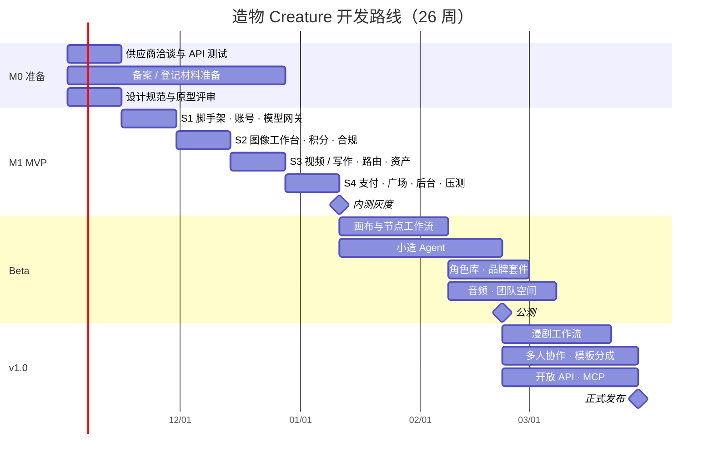

# 07 · 开发计划与里程碑

> 关联文档：[02 PRD](./02-prd.md) · [03 技术架构](./03-architecture.md)

## 1. 总体节奏

| 里程碑 | 周次 | 交付 | 验收口径 |
|---|---|---|---|
| M0 准备 | W1–2 | 供应商合同与测试 Key、技术 PoC、设计规范定稿、原型评审通过 | 模型网关 PoC 跑通 2 家供应商；评审纪要 |
| M1 MVP | W3–10 | 图像 / 视频 / 写作工作台、智能路由、作品库、官方模板、订阅与积分、合规、后台 | 1000 人内测；生成成功率 ≥ 95%；P0 缺陷清零 |
| Beta | W11–18 | 无限画布、小造 Agent、角色库、品牌套件、音频、团队空间 | 公测；Agent 计划确认率 ≥ 50%；付费转化 ≥ 3% |
| v1.0 | W19–26 | 漫剧工作流、多人协作、模板市场分成、开放 API、移动端优化 | 正式发布；WAC ≥ 3 万；MRR ≥ 80 万元 |

> 生成式 AI 应用登记由地方网信部门办理，**必须在 MVP 公开上线前完成**；内测阶段限定邀请用户并做好标识。备案周期存在不确定性，M0 即启动。

## 2. MVP Sprint 拆解

### S1（W3–4）：地基

- [ ] Monorepo、CI、代码规范、环境（dev / staging）
- [ ] 账号：手机号验证码、微信扫码、JWT
- [ ] 模型网关 v1：统一请求结构、2 家供应商适配器、Mock 供应商
- [ ] 任务状态机 + Temporal 工作流骨架 + Worker
- [ ] OSS 转存、缩略图、签名 URL
- [ ] 前端：由 `prototype/` 迁移为 `apps/web`，接入真实登录

### S2（W5–6）：图像闭环

- [ ] 图像工作台（文生图、图生图、参考图）
- [ ] 局部重绘、扩图、消除、抠图、超分
- [ ] 积分账务：账户、批次、冻结 / 结算 / 返还、流水
- [ ] 审核链（提示词、上传、输出）+ 显式 / 隐式标识
- [ ] WebSocket 任务推送

### S3（W7–8）：视频与写作

- [ ] 视频工作台（文生、图生、首尾帧、运镜）
- [ ] 写作工作台（模板、流式输出、选中改写、分镜表）
- [ ] 智能路由 v1（规则特征 + 权重打分 + 熔断）
- [ ] 作品库（文件夹、标签、语义搜索）
- [ ] 官方模板（20 个单步模板）

### S4（W9–10）：商业化与上线准备

- [ ] 订阅、积分包、微信 / 支付宝、发票申请
- [ ] 首页、灵感广场、作品详情、做同款
- [ ] 管理后台 v1（看板、用户、模型、审核、运营）
- [ ] 压测（500 QPS 提交）、安全测试、对账演练
- [ ] 灰度内测、埋点验收

## 3. 团队配置

| 角色 | 人数 | 职责 |
|---|---|---|
| 产品经理 | 1 | 需求、优先级、数据分析 |
| 交互 / 视觉设计 | 2 | 设计规范、页面设计、动效 |
| 前端工程师 | 3 | 用户端、画布、后台 |
| 后端工程师（Node.js） | 3 | 业务服务、账务、支付、实时通道 |
| AI 工程师（Python） | 2 | 模型网关、Worker、自部署推理、Agent |
| 测试工程师 | 1 | 自动化测试、性能测试 |
| SRE / 运维 | 1 | K8s、GPU、观测、成本 |
| 内容安全 / 运营 | 2 | 审核规则、人工复核、模板与社区运营 |
| **合计** | **15** | |

## 4. 成本与定价测算

### 4.1 单位经济（以专业版积分价值 ≈ 0.055 元/积分计）

| 能力 | 用户积分 | 积分收入（元） | 估算成本（元） | 毛利率 |
|---|---|---|---|---|
| 标准图像 · 1K / 张（自部署开源模型） | 2 | 0.11 | 0.04 | 64% |
| 高级图像 · 2K / 张（供应商 API） | 6 | 0.33 | 0.20 | 39% |
| 旗舰图像 · 4K / 张 | 12 | 0.66 | 0.40 | 39% |
| 标准视频 · 720p / 秒（自部署或低价 API） | 8 | 0.44 | 0.20 | 55% |
| 高清视频 · 1080p / 秒（约 $0.07/秒 档 API） | 16 | 0.88 | 0.50 | 43% |
| 旗舰视频 · / 秒（约 $0.15/秒 档 API） | 30 | 1.65 | 1.10 | 33% |

**说明**：
- 成本列基于 2026 年第三方 API 报价与 GPU 租用价估算，**需以正式商务报价替换**。
- 订阅积分存在未使用部分（行业经验约 20%–30%），实际综合毛利高于上表。
- 免费用户只能使用标准模型，单用户每日成本上限约 0.4 元，计入获客成本。
- 智能路由在"自动"模式下优先使用同等质量中成本更低的模型，是毛利的主要调节杆。

### 4.2 基础设施月度预算（MVP 上线后前 3 个月，估算）

| 项 | 月费用（元） |
|---|---|
| K8s 集群（CPU 节点）+ RDS + Redis | 3.5 万 |
| GPU 推理节点（自部署标准模型，按需伸缩） | 6 万 |
| OSS + CDN 流量 | 2 万 |
| 内容审核服务 | 1.5 万 |
| 观测、日志、短信、其他 | 1 万 |
| **合计（不含模型 API 消耗）** | **约 14 万** |

模型 API 费用随用户消耗线性增长，由积分收入覆盖。

## 5. 风险与应对

| 风险 | 影响 | 概率 | 应对 |
|---|---|---|---|
| 登记 / 备案周期超预期 | 无法按期公开上线 | 中 | M0 启动；只调用已备案模型；内测限定邀请制 |
| 供应商涨价、限流或停服 | 成本上升、功能中断 | 中 | 每类能力至少 2 家供应商 + 自部署兜底；路由自动切换 |
| 头部平台价格战 | 获客难、毛利被压缩 | 高 | 差异化在工作流与一致性；聚焦品牌团队和漫剧团队的高价值场景 |
| 生成内容违规 | 监管处罚、下架 | 中 | 三道审核 + 人工复核 + 标识；违规样本库持续训练 |
| 积分账务错误 | 用户投诉、资损 | 低 | 复式记账、幂等、每日对账、积分调整双人复核 |
| Agent 效果不稳定 | 用户信任下降 | 中 | 先计划后执行；预算护栏；保留人工逐节点编辑 |
| GPU 资源紧张 | 排队变长 | 中 | 优先级队列；高峰溢出到 API；提前锁定算力 |

## 6. 阶段指标

| 指标 | MVP 内测 | Beta 公测 | v1.0 |
|---|---|---|---|
| 生成成功率 | ≥ 95% | ≥ 96% | ≥ 97% |
| 首次生成转化（注册 → 首次成功生成） | ≥ 60% | ≥ 70% | ≥ 75% |
| 次周留存 | ≥ 25% | ≥ 30% | ≥ 35% |
| 付费转化（月活） | — | ≥ 3% | ≥ 5% |
| 单件成品平均生成次数 | ≤ 6 | ≤ 5 | ≤ 4 |
| 平均综合毛利率 | — | ≥ 35% | ≥ 45% |
