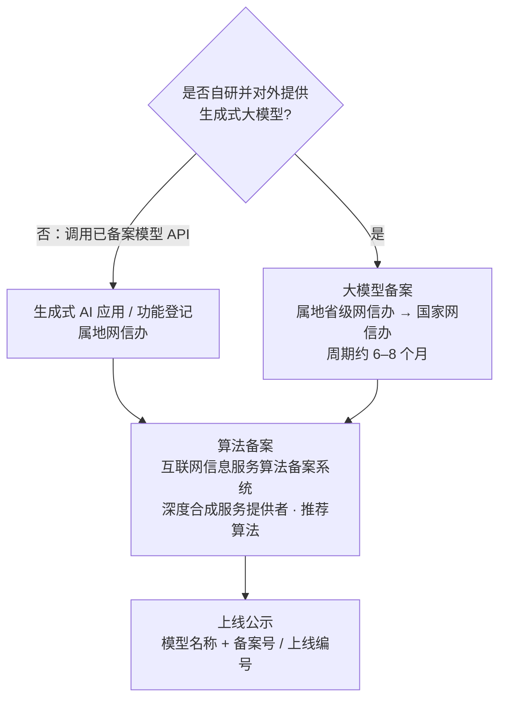
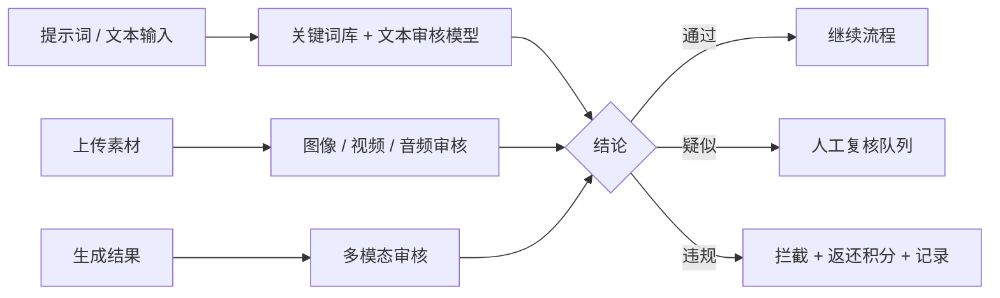

# 08 · 合规与内容安全

> 面向中国大陆提供生成式 AI 服务的合规要求，以及造物平台的落地方案。
> 本文是工程与产品层面的实施说明，**不构成法律意见**；上线前请法务或外部律所复核，并以监管部门最新文件为准。

## 1. 适用法规清单

| 法规 / 标准 | 施行时间 | 对本项目的主要要求 |
|---|---|---|
| 《生成式人工智能服务管理暂行办法》 | 2023-08-15 | 训练与生成内容合法、用户实名、投诉举报、防沉迷、标识、配合监管 |
| 《互联网信息服务深度合成管理规定》 | 2023-01-10 | 深度合成服务提供者的算法备案、标识、真人人脸 / 声音编辑需取得单独同意 |
| 《互联网信息服务算法推荐管理规定》 | 2022-03-01 | 灵感广场推荐算法的备案与透明度、用户可关闭个性化推荐 |
| 《人工智能生成合成内容标识办法》 | 2025-09-01 | 显式标识 + 隐式标识；下载 / 导出保留标识；用户协议说明标识方式 |
| GB 45438-2025《网络安全技术 人工智能生成合成内容标识方法》 | 2025-09-01 | 标识的具体位置、样式、元数据格式（强制性国家标准） |
| 《个人信息保护法》《数据安全法》《网络安全法》 | 已施行 | 个人信息处理规则、数据分类分级、日志留存、安全事件响应 |
| 《网络数据安全管理条例》 | 2025-01-01 | 网络数据处理者义务、个人信息保护细化要求 |
| 《未成年人网络保护条例》 | 2024-01-01 | 未成年人模式、防沉迷、内容过滤 |

## 2. 备案与登记路径



**造物的选择**：第一阶段不自研基础模型，只调用已备案模型（火山方舟、可灵、阿里云百炼等），走"应用登记 + 算法备案"路径。

**执行清单**：
- [ ] 确认每个接入模型的备案状态，在 `models.filing_no` 中维护备案号。
- [ ] 准备登记材料：服务说明、所调用模型及备案信息、安全评估报告、内容审核机制说明、标识实施说明、用户协议与隐私政策。
- [ ] 办理深度合成服务提供者算法备案；灵感广场上线个性化推荐前办理推荐算法备案。
- [ ] 上线后在页脚与"关于 / 算法公示"页公示模型名称与备案号 / 上线编号。
- [ ] 自部署开源模型对外提供服务前，单独评估是否触发大模型备案义务。

截至 2026 年 8 月 31 日，累计 1112 款生成式 AI 服务完成备案、731 款应用或功能完成登记（来源见文末），说明"调用已备案模型 + 登记"是主流路径。

## 3. 内容标识实施方案

### 3.1 显式标识（用户可感知）

| 内容 | 位置与形式 | 实现 |
|---|---|---|
| 图像 | 画面角落添加"AI 生成"文字标识 | Worker 后处理用 libvips 叠加；文字高度参考国标要求（不低于画面最短边的一定比例，开发时以标准原文为准） |
| 视频 | 起始画面与播放过程中的适当位置添加文字标识 | FFmpeg 叠加角标 + 片头标识帧 |
| 音频 | 起始（或首尾、中间）添加语音提示或节奏提示 | 拼接提示音频片段 |
| 文本 | 内容起始、末尾或适当位置添加文字提示 | 写作结果导出 / 复制时自动附加 |
| 交互界面 | 生成结果展示区标注"AI 生成" | 前端组件统一角标 |

**规则**：
- 下载、复制、导出、分享链接打开时，文件必须带显式标识。
- "去水印"权益只去掉平台品牌 Logo，**不得去除法定标识**。
- 用户上传的非 AI 素材不加标识；经过 AI 编辑的上传素材视为生成合成内容，需加标识。

### 3.2 隐式标识（文件元数据）

在文件元数据中写入 AIGC 标识字段，参考国标附录的结构：

```json
{
  "AIGC": {
    "Label": "1",
    "ContentProducer": "<服务提供者名称或编码>",
    "ProduceID": "CRT-20261026-8F3K2",
    "ReservedCode1": "<完整性校验值>",
    "ContentPropagator": "<传播平台名称或编码>",
    "PropagateID": "<传播内容编号>",
    "ReservedCode2": ""
  }
}
```

| 格式 | 写入位置 |
|---|---|
| PNG / JPEG / WebP | XMP（必要时同时写 EXIF UserComment） |
| MP4 / MOV | 容器级 `udta` / XMP 元数据 |
| MP3 / WAV | ID3 / INFO 块 |
| 文本 | 导出为文件（docx / md）时写入文档属性 |

- `ProduceID` 与数据库 `assets.content_id` 一致，可反查生成任务与用户。
- 字段名、取值和编码方式**以 GB 45438-2025 原文为准**，开发时由安全负责人逐条核对。
- 面向海外分发时可额外附加 C2PA 清单，二者不冲突。

### 3.3 标识服务的工程约束

- 标识由 Worker 后处理阶段统一完成，业务代码无法绕过。
- 原始无标识文件只存放在内部私有桶（`raw_storage_key`），任何对外接口都不返回该地址。
- 自动化测试：每个输出格式都有"标识存在性"检查用例，CI 必跑。

## 4. 内容审核

### 4.1 三道审核



| 环节 | 机审 | 人审 |
|---|---|---|
| 提示词 | 关键词 + 语义模型，< 100 ms | 不做实时人审 |
| 上传素材 | 第三方审核服务（涉政、色情、暴恐、广告、人脸识别） | 疑似内容进入队列 |
| 生成结果 | 同上 | 疑似内容进入队列；发布到广场的作品抽样人审 |
| 广场作品 / 评论 | 机审 | 举报内容 100% 人审 |

**审核策略配置**：分级阈值（通过 / 复核 / 拦截）在后台按标签配置；未成年人模式使用更严格阈值。

### 4.2 特殊场景

| 场景 | 要求 |
|---|---|
| 真人肖像生成 / 编辑 | 识别到真人人脸时提示需取得本人同意；公众人物默认拦截；角色库中的真人角色需上传肖像授权 |
| 声音克隆 | 必须录制本人朗读的授权声明，并经人工审核；不支持克隆他人声音 |
| 数字人 / 对口型 | 同肖像要求；输出加显式标识 |
| 品牌与商标 | 品牌套件只允许上传用户有权使用的 Logo；侵权投诉走通知—删除流程 |

### 4.3 投诉举报

- 入口：作品详情页、画布分享页、个人主页、"帮助与反馈"。
- 内部处理时限：一般举报 24 小时内处理，紧急（涉政、未成年人）2 小时内处理。
- 处理结果通知举报人与被举报人，被举报人可申诉。

## 5. 个人信息与数据安全

| 项 | 措施 |
|---|---|
| 实名 | 手机号验证即满足基础实名；未绑定手机号不可生成 |
| 最小必要 | 只收集手机号、微信 OpenID、设备信息（风控）；不读取通讯录等 |
| 敏感信息 | 手机号加密存储；人脸参考图属于敏感个人信息，单独授权、单独存储、可随时删除 |
| 训练使用 | 默认**不使用**用户作品与提示词训练模型；如需使用，单独征得同意并可撤回 |
| 跨境 | 国内用户数据存储在境内；海外版独立部署、数据不互通 |
| 日志 | 生成日志、登录日志留存 ≥ 6 个月；后台审计日志 ≥ 3 年 |
| 用户权利 | 查询、复制、更正、删除个人信息，注销账号（15 天冷静期） |
| 安全事件 | 应急预案，按规定时限向监管报告并通知受影响用户 |

## 6. 未成年人保护

- 注册时引导选择是否为未成年人；疑似未成年人（行为识别）提示开启未成年人模式。
- 未成年人模式：限制使用时长（每日 1 小时，22:00–8:00 不可用）、不可充值、仅可使用标准模型、更严格的内容阈值、隐藏社区评论区。

## 7. 用户协议要点

- 说明生成合成内容的显式与隐式标识方式和样式，提示用户不得删除、篡改、伪造、隐匿标识。
- 生成内容的权利归属与商用授权范围（按套餐区分），以及用户对其输入内容（提示词、上传素材）合法性负责。
- 禁止用途清单：违法违规内容、侵犯他人肖像权 / 名誉权 / 知识产权、冒充他人、虚假新闻、诈骗等。
- 平台对违规账号的处理措施：警告、限制功能、封禁，并依法保存记录、向主管部门报告。

## 8. 上线前合规检查表

- [ ] 应用登记 / 算法备案完成，公示信息已上线
- [ ] 所有输出格式的显式与隐式标识通过自动化测试
- [ ] 下载、复制、分享链路均保留标识
- [ ] 三道审核接入，人工复核队列有人值守
- [ ] 举报入口全覆盖，处理 SLA 生效
- [ ] 用户协议、隐私政策、算法公示、标识说明经法务审核
- [ ] 未成年人模式可用
- [ ] 日志留存与审计日志配置完成
- [ ] 安全测试（渗透测试、依赖漏洞扫描）通过

## 9. 参考资料

- [国家网信办：人工智能生成合成内容标识办法](https://www.cac.gov.cn/2025-03/14/c_1743654685899683.htm)
- [新华网：标识办法发布报道](https://www.news.cn/politics/20250314/b7a24028f2924b7681e6ed1bfbd8fade/c.html)
- [普华永道：标识办法解读（2025-09）](https://www.pwccn.com/zh/tmt/method-identifying-synthetic-content-generated-ai-sep2025.pdf)
- [君合法评：生成式 AI 备案与登记实务](https://junhe.com/law-reviews/2974)
- [同花顺：生成式 AI 服务备案与登记统计](https://news.10jqka.com.cn/20260629/c677812837.shtml)
